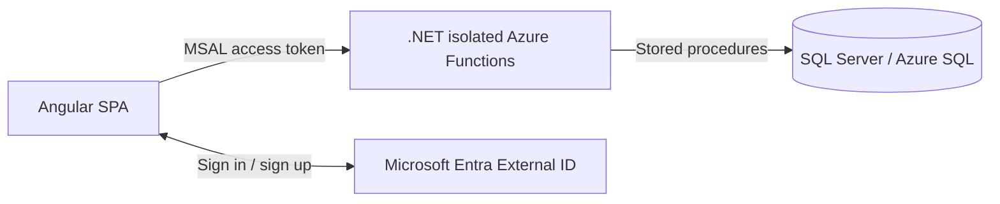

# Smart Blood and Medical Resource Availability System (SBMRAS)

SBMRAS is a blood and medical-resource availability portal with a public search/request experience and role-based tools for hospitals, blood banks, and administrators.

## Architecture

- **Web:** Angular 20 SPA using MSAL for Microsoft Entra External ID.
- **API:** .NET 10 Azure Functions (isolated worker).
- **Data:** SQL Server locally; Azure SQL for deployed environments. The API accesses data through stored procedures.
- **Authorization:** API permissions and application roles are enforced server-side. Local development can use seeded demo identities; deployed environments must use Entra ID.



## Repository layout

| Path | Contents |
|---|---|
| `SBMRAS.Web/` | Angular application, top navigation, public and role-specific pages |
| `SBMRAS.API/` | Azure Functions endpoints, middleware, local settings |
| `SBMRAS.Application/`, `SBMRAS.Domain/`, `SBMRAS.Infrastructure/` | Application contracts, domain logic, SQL access and numbered SQL scripts |
| `scripts/database/` | SQL migration and script runner |
| `deploy/`, `.github/workflows/` | Entra/deployment runbooks and CI/CD |
| `docs/` | Authentication and authorization design |
| `SBMRAS_CONTRACT.md` | Shared API, database, authorization, and UI conventions |

## Local development

### Prerequisites

- Windows, .NET 10 SDK, Node.js 24 or newer, npm, and Azure Functions Core Tools v4.
- A local SQL Server instance and `sqlcmd`. The default connection uses Windows authentication to `localhost`.

### 1. Create and seed the database

From the repository root, run PowerShell:

```powershell
.\scripts\database\Invoke-SqlMigrations.ps1 -Mode Apply -CreateDatabase
```

This creates the local `SBMRAS` database and applies the ordered, idempotent scripts, including reference/demo data. To target another SQL Server, pass `-Server` and `-Database`, or use `-ConnectionString`. See the migration script help for `Plan`, `Baseline`, and deployment-script options.

### 2. Configure and run the API

```powershell
Copy-Item .\SBMRAS.API\local.settings.sample.json .\SBMRAS.API\local.settings.json
cd .\SBMRAS.API
func start --port 7073
```

Update the SQL connection string in `local.settings.json` if your local SQL Server differs. The sample uses `Auth:Mode=DevHeader` for local-only development and is configured for the Angular origin `http://localhost:4400`. Keep `local.settings.json` private; it is ignored by Git. Do not deploy the sample's `DevHeader`, local SQL, secret-storage, or health-monitor settings.

### 3. Run the Angular app

In another terminal:

```powershell
cd .\SBMRAS.Web
npm ci
npm start
```

Open `http://localhost:4400`. The development proxy forwards `/api` requests to the local Functions host. Local demo user IDs can be retrieved from `GET /api/v1/auth/dev-users`; the API accepts `X-User-Id` only in `DevHeader` mode.

### 4. Validate

```powershell
dotnet build .\SBMRAS.API.slnx
cd .\SBMRAS.Web
npm test -- --watch=false
npm run build
```

SQL integration tests require a test connection string targeting a database whose name ends with `_Test`; see the CI workflow. Do not point tests at a production database.

## Microsoft Entra and deployment

The app registrations, External ID sign-up/sign-in flow, API scope, claims, groups, roles, local/deployed configuration, and production security checklist are documented in:

- [Authentication & Authorization Design](docs/SBMRAS_Authentication_Authorization_Design.md)
- [Entra External ID setup runbook](deploy/entra-external-id-setup.md)

Before deploying, configure an External ID tenant and the `SBMRAS-Web` and `SBMRAS-API` registrations, set the API to `Auth:Mode=EntraId`, provide the environment-specific settings/secrets required by the deployment workflows, and configure allowed origins and database identity/permissions. The Entra portal configuration and evidence screenshots are environment-specific and must be captured in the target tenant; this repository does not include tenant credentials or fabricated portal screenshots.

GitHub Actions workflows are under `.github/workflows/`: `ci.yml` validates builds/tests, while `deploy-api.yml`, `deploy-web.yml`, and `deploy-database.yml` handle environment deployments. Configure their documented repository variables and secrets before enabling deployment.

## Authorization summary

| Capability | Public | Hospital Management | Blood Bank | Admin |
|---|---:|---:|---:|---:|
| Search availability / create blood requests | Yes | Yes | Yes | Yes |
| Manage hospital data / approve requests | No | Yes | No | Yes |
| Manage blood stock and availability | No | No | Yes | Yes |
| Reports | No | Yes | Yes | Yes |
| User, audit, master-data, and system administration | No | No | No | Yes |

Public features do not require a security group. Institutional permissions must be granted by assigning the corresponding Entra security group to the matching API application role; API authorization remains the enforcement boundary.