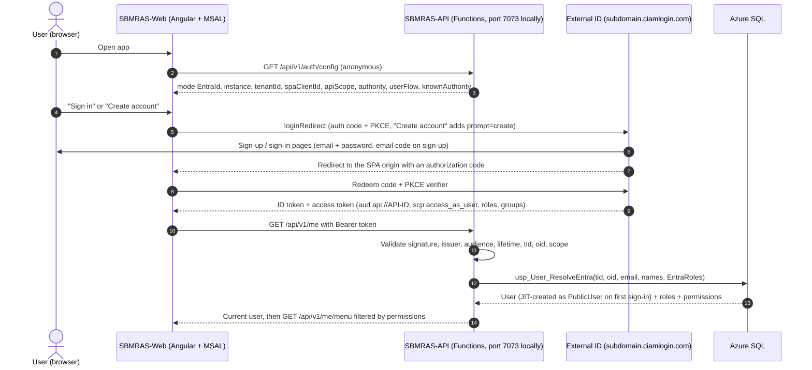

# Microsoft Entra External ID setup for SBMRAS (portal runbook)

This runbook configures public self-registration and institutional authorization for SBMRAS. Run it once per tenant, and repeat
§3–§7 and §10 for each environment (dev/test/prod). The design rationale, diagrams and threat model are in
[`docs/SBMRAS_Authentication_Authorization_Design.md`](../docs/SBMRAS_Authentication_Authorization_Design.md); this file is the
click-by-click procedure. Screenshot IDs (`S-xx`) refer to §11 of that document; save captures under
`docs/evidence/entra/S-xx_<name>.png`.

What you will create:

| Object | Value |
|---|---|
| User flow | `SBMRAS-SignUpSignIn` (referenced as `B2X_1_SBMRAS-SignUpSignIn`), Email with password, email verification |
| App registration (SPA) | `SBMRAS-Web` — public client, auth code + PKCE, no secret |
| App registration (API) | `SBMRAS-API` — `api://<SBMRAS-API-CLIENT-ID>`, scope `access_as_user`, app roles `HospitalManagement`, `BloodBank`, `Admin` |
| Security groups | `SBMRAS-HospitalManagement`, `SBMRAS-BloodBank`, `SBMRAS-Admin` (each assigned to the matching app role) |
| Token claims | `email`, `given_name`, `family_name`, `preferred_username`, `groups`, `roles` |

Portal names follow the [Microsoft Entra admin center](https://entra.microsoft.com/) (November 2026). The Azure portal shows the same
blades under **Microsoft Entra ID**. If Microsoft renames a blade, use the portal search box with the blade name given here.
Reference: [Microsoft Entra External ID documentation](https://learn.microsoft.com/entra/external-id/customers/).

**Prerequisites**

- An Azure subscription and an account that can create tenants (**Tenant Creator**) — afterwards you are Global Administrator of
  the new external tenant.
- SBMRAS API and web deployed or runnable locally (`func start` on port **7073**, `ng serve --port 4400`).
- A worksheet to record IDs (none of them are secrets):

| Item | Value | Goes to |
|---|---|---|
| External tenant ID | | `ENTRA_TENANT_ID` / `Auth:Entra:TenantId` |
| Tenant subdomain | `<subdomain>` | `ENTRA_AUTHORITY` = `https://<subdomain>.ciamlogin.com/` |
| SBMRAS-API client ID | | `ENTRA_API_CLIENT_ID` / `Auth:Entra:ClientId` |
| SBMRAS-API App ID URI | `api://<SBMRAS-API-CLIENT-ID>` | `ENTRA_API_AUDIENCE` / `Auth:Entra:Audience` |
| SBMRAS-Web client ID | | `ENTRA_SPA_CLIENT_ID` / `Auth:Entra:SpaClientId` |
| SBMRAS-HospitalManagement object ID | | `ENTRA_GROUP_HOSPITAL_ID` / `Auth:Entra:Groups:HospitalManagement` |
| SBMRAS-BloodBank object ID | | `ENTRA_GROUP_BLOODBANK_ID` / `Auth:Entra:Groups:BloodBank` |
| SBMRAS-Admin object ID | | `ENTRA_GROUP_ADMIN_ID` / `Auth:Entra:Groups:Admin` |

## Flow overview



---

## 1. Create the external tenant

1. Sign in to the [Microsoft Entra admin center](https://entra.microsoft.com/).
2. **Entra ID › Overview › Manage tenants › Create**.
3. Select **External** › **Continue**. Choose **Use Azure Subscription**.
4. **Basics**: Tenant name `SBMRAS Customers` (prod: `SBMRAS`), Domain name e.g. `sbmrascustomers`, Country/Region (cannot be changed
   later). **Add a subscription**: subscription + resource group `rg-sbmras-identity`. **Review + create** (can take up to 30 min).
5. Switch to the new tenant: **Settings** (gear) › **Directories + subscriptions** › **Switch**.
6. **Entra ID › Overview**: record **Tenant ID** and the primary domain `<subdomain>.onmicrosoft.com`.
   Instance = `https://<subdomain>.ciamlogin.com/`. — **S-01**

All remaining steps are done **inside the external tenant**.

> Recommendation: use one external tenant for dev/test and a **separate** tenant for production. At minimum, use separate
> `SBMRAS-Web` registrations so production has no `localhost` redirect URIs.

## 2. Enable the email + password method and SSPR

1. **Entra ID › External Identities › All identity providers** › **Built-in** tab: confirm **Email accounts** is configured with
   **Email with password**.
2. **Entra ID › Authentication methods › Policies** › **Email OTP** › **Enable** › target **All users** › **Save**
   (needed for "Forgot password?" self-service reset and for email MFA).
3. (Optional) **Entra ID › Company branding** › **Default sign-in** › **Edit**: SBMRAS logo, banner logo, background colour
   `#0B1F33`, footer privacy/terms links. Branding helps users recognise the genuine sign-in page.

## 3. Register the API app (`SBMRAS-API`)

1. **Entra ID › App registrations › New registration**.
   - Name `SBMRAS-API`.
   - Supported account types: **Accounts in this organizational directory only**.
   - Redirect URI: none. **Register**.
   - Record **Application (client) ID** → `ENTRA_API_CLIENT_ID`. — **S-11**
2. **Expose an API**:
   1. **Application ID URI › Add** → accept `api://<SBMRAS-API-CLIENT-ID>` › **Save**.
   2. **Add a scope**:
      - Scope name `access_as_user`
      - Who can consent: **Admins and users**
      - Admin consent display name `Access SBMRAS API as the signed-in user`
      - Admin consent description `Allows SBMRAS Web to call the SBMRAS API on behalf of the signed-in user.`
      - User consent display name `Access SBMRAS on your behalf`
      - User consent description `Allows SBMRAS to search availability and manage your blood requests as you.`
      - State **Enabled** › **Add scope**. — **S-12**
3. **App roles › Create app role** (three times). For each: Allowed member types **Users/Groups**, **Do you want to enable this app
   role?** ticked.

   | Display name | Value | Description |
   |---|---|---|
   | Hospital Management | `HospitalManagement` | Manage assigned hospital profile and medical resources, coordinate/approve blood requests, hospital reports. |
   | Blood Bank | `BloodBank` | Manage assigned blood bank stock and availability, coordinate requests, blood bank reports. |
   | Administrator | `Admin` | Full SBMRAS administration: users, roles, facility verification, master data, settings, audit. |

   The **Value** must match exactly (case-sensitive) — it equals `Roles.RoleCode` in the database. — **S-13**
4. **Manifest** (Microsoft Graph format):
   - Set `"api": { "requestedAccessTokenVersion": 2, ... }` (legacy format: `"accessTokenAcceptedVersion": 2`).
   - Optional but recommended for consistency across environments: replace the generated `appRoles[].id` values with the fixed IDs
     below (do this **before** any assignment exists; otherwise disable the role, save, then edit).

     | Value | Fixed `id` |
     |---|---|
     | `HospitalManagement` | `e00c2ed0-e13c-404c-b3ab-300668ce411d` |
     | `BloodBank` | `d4f0a58f-62bd-43ae-bd71-50172441f559` |
     | `Admin` | `efde6267-13b6-4a66-bd48-8ebb78f165a5` |
     | scope `access_as_user` | `b12561bc-2e80-4943-b072-0e3f59f96337` |

   - **Save**. — **S-14**
5. **Token configuration**:
   1. **Add optional claim** › Token type **Access** › tick `email`, `family_name`, `given_name`, `preferred_username` › **Add**.
      Accept the prompt **Turn on the Microsoft Graph email, profile permission**.
   2. **Add groups claim** › tick **Security groups** › under *Customize token properties by type* leave **Group ID** for Access/ID
      tokens › **Emit groups as role claims: leave unticked** › **Add**.
      This sets `groupMembershipClaims: "SecurityGroup"`.
      > Emitting groups as role claims would replace the `HospitalManagement`/`BloodBank`/`Admin` values in `roles` with group IDs and
      > break authorization. Keep it off.
   — **S-15**
6. **Certificates & secrets**: confirm **no** secrets and **no** certificates. The API never needs one. — **S-16**
7. **Owners**: add two named owners.

## 4. Register the SPA app (`SBMRAS-Web`)

1. **Entra ID › App registrations › New registration**.
   - Name `SBMRAS-Web`, **Accounts in this organizational directory only**.
   - Redirect URI: platform **Single-page application (SPA)**, `http://localhost:4400`. **Register**.
   - Record **Application (client) ID** → `ENTRA_SPA_CLIENT_ID`. — **S-07**
2. **Authentication** › **Single-page application** › **Add URI** for every origin. The SPA uses `window.location.origin` as redirect
   and post-logout URI, so add the **origin only, no path, no trailing slash**:

   | Environment | URI |
   |---|---|
   | Local | `http://localhost:4400` |
   | Dev | `https://sbmras-web-dev.azurewebsites.net` |
   | Test | `https://sbmras-web-test.azurewebsites.net` |
   | Prod | `https://sbmras-web-prod.azurewebsites.net` and the custom domain, e.g. `https://sbmras.example.org` |

   - **Front-channel logout URL**: leave blank.
   - **Implicit grant and hybrid flows**: both **unchecked** (MSAL uses auth code + PKCE).
   - **Allow public client flows**: **No**. **Save**. — **S-08**
3. **Certificates & secrets**: confirm none exist. — **S-09**
4. **API permissions › Add a permission**:
   - **APIs my organization uses** (or **My APIs**) › `SBMRAS-API` › **Delegated permissions** › `access_as_user` › **Add**.
   - **Microsoft Graph › Delegated**: ensure `openid` and `offline_access` are present.
   - **Grant admin consent for <tenant>** › **Yes**. All rows must show **Granted**. — **S-10**
5. Back in **SBMRAS-API › Expose an API › Authorized client applications › Add a client application**: client ID of `SBMRAS-Web`,
   tick `api://<SBMRAS-API-CLIENT-ID>/access_as_user` › **Add application**. (Pre-authorization: users are never asked to consent.)
6. **Token configuration** (ID token, used only for UI display): **Add optional claim** › **ID** › `email`, `family_name`,
   `given_name`, `preferred_username` › **Add**.
7. **Owners**: add two named owners.

## 5. Create the "Sign up and sign in" user flow

1. **Entra ID › External Identities › User flows › New user flow**.
2. Name: `SBMRAS-SignUpSignIn` (the portal and documentation refer to it as `B2X_1_SBMRAS-SignUpSignIn`).
3. **Identity providers**: **Email Accounts › Email with password**.
   (Do not choose *Email one-time passcode* as the sign-in method; the user must create a password. Email ownership is still
   verified by a one-time code during sign-up.)
4. **User attributes** (collected on sign-up): tick **Given Name**, **Surname**, **Display Name** (Email Address is always collected).
5. **Create**. — **S-02**, **S-03**, **S-04**
6. **Add the SPA to the flow (critical)**: open the user flow › **Usage › Applications › Add application** › select **`SBMRAS-Web`** ›
   **Select**. Without this the sign-in page has no "No account? Create one" link and *Create account* fails. An application can be
   linked to only one user flow. — **S-05**
7. (Optional) **User flow › Page layouts / Languages** for wording and localisation.
8. (Optional) **Run user flow** is not available for External ID; test from the app (§11).

Public registration: any person can sign up. Sign-up never adds a user to a group, so a new account is always a `PublicUser`.

## 6. Create security groups

**Entra ID › Groups › All groups › New group** (three times):

| Group type | Group name | Description | Membership type | Owners | Members |
|---|---|---|---|---|---|
| Security | `SBMRAS-HospitalManagement` | SBMRAS hospital management operators | Assigned | SBMRAS admin lead + deputy | none yet |
| Security | `SBMRAS-BloodBank` | SBMRAS blood bank operators | Assigned | SBMRAS admin lead + deputy | none yet |
| Security | `SBMRAS-Admin` | SBMRAS platform administrators | Assigned | IAM owner + deputy | first admin(s) |

- *Microsoft Entra roles can be assigned to the group*: **No**.
- Record each group's **Object ID**. — **S-17**, **S-18**
- Do not nest groups (nested membership is not used for app-role assignment).

## 7. Assign groups to app roles (Enterprise application)

1. **Entra ID › Enterprise applications** › (filter *Application type: All applications*) › **SBMRAS-API**.
2. **Users and groups › Add user/group**:
   - Users and groups: `SBMRAS-HospitalManagement` › Select a role: **Hospital Management** › **Assign**.
   - Repeat: `SBMRAS-BloodBank` → **Blood Bank**; `SBMRAS-Admin` → **Administrator**. — **S-19**
3. **Properties** of **SBMRAS-API**: **Assignment required?** = **No** (public users must still get tokens), **Visible to users?** = No.
   **Save**. — **S-20**
4. **Enterprise applications › SBMRAS-Web › Properties**: **Assignment required?** = **No**. — **S-21**

The `roles` claim in the **access token** comes from assignments on the **SBMRAS-API** enterprise application (the token audience),
not from `SBMRAS-Web`.

## 8. Configure the API (Function App / local)

Azure app settings use `__`; `local.settings.json` uses `:`. On Azure these come from GitHub environment variables through IaC and
the **Deploy API** workflow.

| App setting (Azure) | GitHub variable | Value |
|---|---|---|
| `Auth__Mode` | (fixed by IaC) | `EntraId` |
| `Auth__Entra__Instance` | `ENTRA_AUTHORITY` | `https://<subdomain>.ciamlogin.com/` |
| `Auth__Entra__TenantId` | `ENTRA_TENANT_ID` | external tenant ID |
| `Auth__Entra__ClientId` | `ENTRA_API_CLIENT_ID` | `SBMRAS-API` client ID |
| `Auth__Entra__SpaClientId` | `ENTRA_SPA_CLIENT_ID` | `SBMRAS-Web` client ID |
| `Auth__Entra__Audience` | `ENTRA_API_AUDIENCE` | `api://<SBMRAS-API-CLIENT-ID>` (blank = default) |
| `Auth__Entra__RequiredScope` | `ENTRA_API_SCOPE` | `access_as_user` |
| `Auth__Entra__UserFlow` | `ENTRA_USER_FLOW` | `B2X_1_SBMRAS-SignUpSignIn` |
| `Auth__Entra__Groups__HospitalManagement` | `ENTRA_GROUP_HOSPITAL_ID` | group object ID (blank = not mapped) |
| `Auth__Entra__Groups__BloodBank` | `ENTRA_GROUP_BLOODBANK_ID` | group object ID |
| `Auth__Entra__Groups__Admin` | `ENTRA_GROUP_ADMIN_ID` | group object ID |
| `Cors__AllowedOrigins` | derived from web app name + `WEB_ORIGINS` | exact SPA origin(s), comma-separated |

Local testing against the real tenant — edit `SBMRAS.API/local.settings.json` (git-ignored, never commit):

```json
"Auth:Mode": "EntraId",
"Auth:Entra:Instance": "https://<subdomain>.ciamlogin.com/",
"Auth:Entra:TenantId": "<TENANT-ID>",
"Auth:Entra:ClientId": "<SBMRAS-API-CLIENT-ID>",
"Auth:Entra:SpaClientId": "<SBMRAS-WEB-CLIENT-ID>",
"Auth:Entra:Audience": "api://<SBMRAS-API-CLIENT-ID>",
"Auth:Entra:RequiredScope": "access_as_user",
"Auth:Entra:UserFlow": "B2X_1_SBMRAS-SignUpSignIn",
"Auth:Entra:Groups:HospitalManagement": "<GROUP-OBJECT-ID>",
"Auth:Entra:Groups:BloodBank": "<GROUP-OBJECT-ID>",
"Auth:Entra:Groups:Admin": "<GROUP-OBJECT-ID>",
"Cors:AllowedOrigins": "http://localhost:4400"
```

Switch back to `"Auth:Mode": "DevHeader"` for normal seeded-user development. **Never** deploy `DevHeader` to a reachable host.

Azure CLI alternative (per environment):

```powershell
az functionapp config appsettings set -g rg-sbmras-dev -n sbmras-func-dev --settings `
  "Auth__Mode=EntraId" `
  "Auth__Entra__Instance=https://<subdomain>.ciamlogin.com/" `
  "Auth__Entra__TenantId=<TENANT-ID>" `
  "Auth__Entra__ClientId=<SBMRAS-API-CLIENT-ID>" `
  "Auth__Entra__SpaClientId=<SBMRAS-WEB-CLIENT-ID>" `
  "Auth__Entra__Audience=api://<SBMRAS-API-CLIENT-ID>" `
  "Auth__Entra__RequiredScope=access_as_user" `
  "Auth__Entra__UserFlow=B2X_1_SBMRAS-SignUpSignIn" `
  "Auth__Entra__Groups__HospitalManagement=<GROUP-OBJECT-ID>" `
  "Auth__Entra__Groups__BloodBank=<GROUP-OBJECT-ID>" `
  "Auth__Entra__Groups__Admin=<GROUP-OBJECT-ID>" `
  "Cors__AllowedOrigins=https://sbmras-web-dev.azurewebsites.net"
az functionapp cors add -g rg-sbmras-dev -n sbmras-func-dev --allowed-origins https://sbmras-web-dev.azurewebsites.net
```

Capture **Function App › Settings › Environment variables** (**S-24**) and **API › CORS** (**S-25**). Confirm
**Function App › Settings › Authentication** (Easy Auth) is **not** enabled, because SBMRAS validates tokens in code.

**Web**: no rebuild is needed for identity changes; the SPA reads everything from `GET /api/v1/auth/config`. The web host CSP must
allow `https://*.ciamlogin.com` in `connect-src`, `frame-src` and `form-action`.

## 9. Database and first administrator

1. Apply SQL scripts `01`–`12` (`SBMRAS.Infrastructure\SQL`) and `Deployment\GrantRuntimeIdentity.sql` for the Function App identity.
2. Provision the first admin (Local `Admin` role; linked to the Entra account on first sign-in by verified email):

   ```powershell
   sqlcmd -S <server> -d SBMRAS -v AdminEmail="admin@example.org" AdminDisplayName="SBMRAS Administrator" `
     -i SBMRAS.Infrastructure\SQL\Deployment\ProvisionAdmin.sql
   ```

3. Add the same person to `SBMRAS-Admin` (§6) so the Entra `Admin` role is also present.
4. Create two **break-glass** accounts (cloud-only, `<name>@<subdomain>.onmicrosoft.com`), add them to `SBMRAS-Admin`, provision them
   with `ProvisionAdmin.sql`, store credentials offline, exclude them from Conditional Access and alert on their sign-ins.

## 10. Onboard institutional users (joiner / mover / leaver)

**Joiner**

1. The staff member signs up in SBMRAS (or an Admin pre-creates them in **Administration › Users & Access**).
2. The facility manager submits an access request (name, email, facility code, role, justification).
3. Admin verifies identity and that the facility is **Verified** and active.
4. **Entra ID › Groups › SBMRAS-BloodBank** (or `SBMRAS-HospitalManagement`) › **Members › Add members** › select the user.
5. **SBMRAS › Administration › Users & Access** › user › **Facilities**: add the facility with role Manager / Operator / Verifier.
6. The user signs out and in. Check: role chip shows **Blood Bank (Entra)**, menu shows **Facility Operations**, an audit entry exists.
   — **S-26**

**Mover**: move the user between groups in Entra; end the old facility assignment and add the new one in SBMRAS. The new role appears
in the next access token (≤ ~90 min, or immediately after sign-out/in).

**Leaver**: (1) SBMRAS: set the user **Inactive** (next API call → 401); (2) Entra: remove from all `SBMRAS-*` groups; (3) SBMRAS: end
facility assignments and remove Local roles; (4) **Entra ID › Users › *user* › Revoke sessions**; delete or block the account if
required.

**Fallback (SDD §6.3)**: if testing in §11 shows the external tenant does not emit `roles` for group assignments, assign the role
in **SBMRAS › Administration › Users & Access** (Local role) instead. Local roles are never removed by token sync. Apply the same
approval and review process.

## 11. Verify

1. `GET https://<api>/api/v1/auth/config` (locally `http://localhost:7073/api/v1/auth/config`) →
   `mode: "EntraId"`, `instance` = `https://<subdomain>.ciamlogin.com/`, `authority` = `https://<subdomain>.ciamlogin.com/<tenantId>`,
   `apiScope` = `api://<SBMRAS-API-CLIENT-ID>/access_as_user`, `userFlow` = `B2X_1_SBMRAS-SignUpSignIn`,
   `knownAuthority` = `<subdomain>.ciamlogin.com`.
2. Open the web app (`http://localhost:4400` or the environment URL) › **Sign in / Register** › **Create account** › enter an email,
   enter the emailed verification code, set a password, given name, surname. — **S-06**
3. You return signed in with **Overview / Discover / Requests** only (no Facility Operations, Insights or Administration).
4. Decode the access token (browser devtools › Network › request header `Authorization`, paste into <https://jwt.ms> — test
   accounts only): `aud` = `api://<SBMRAS-API-CLIENT-ID>`, `scp` = `access_as_user`, **no** `roles`, **no** `groups`. — **S-22**
5. SQL:

   ```sql
   SELECT u.UserId, u.DisplayName, u.Email, u.EntraObjectId, u.IsSelfRegistered, u.IsActive, r.RoleCode, ur.Source
   FROM dbo.Users u
   JOIN dbo.UserRoles ur ON ur.UserId = u.UserId
   JOIN dbo.Roles r ON r.RoleId = ur.RoleId
   WHERE u.Email = N'<new user email>';
   ```

   Expect one active user with `EntraObjectId` set, `IsSelfRegistered = 1` and one row `PublicUser`.
6. Sign out and sign in again: same `UserId` (no duplicate).
7. Add the test user to `SBMRAS-BloodBank`, assign a blood bank in SBMRAS, sign out/in. Decode the token: `roles: ["BloodBank"]` and
   (if supported) `groups: ["<object id>"]`, plus `email`, `given_name`, `family_name`, `preferred_username`. — **S-23**
   Record the result as Mode **A** (roles + groups), **B** (roles only) or **C** (neither → use Local roles) in the go-live checklist.
8. SQL: a `UserRoles` row `BloodBank` with `Source = 'Entra'` now exists.
9. Negative tests (devtools or a REST client with the test token): — **S-27**
   - `GET /api/v1/admin/users` as the BloodBank user → **403**.
   - `GET /api/v1/facilities/<unassigned blood bank id>/blood-stock` → **403** "You are not assigned to this facility."
   - `GET /api/v1/me` without `Authorization` → **401**.
10. Remove the user from the group, sign out/in: `BloodBank` (Entra) row disappears; the menu shrinks.

## 12. Optional hardening

- **Conditional Access** (**Entra ID › Protection › Conditional Access › New policy**): users = `SBMRAS-Admin`,
  `SBMRAS-HospitalManagement`, `SBMRAS-BloodBank`; target resources = `SBMRAS-Web`, `SBMRAS-API`; grant = **Require multifactor
  authentication**; exclude break-glass accounts. — **S-31**
- **Groups claim limited to assigned groups**: **SBMRAS-API › Token configuration › Edit groups claim** › **Groups assigned to the
  application** (prevents overage).
- **Sign-in logs**: **Entra ID › Monitoring & health › Diagnostic settings** › send `SignInLogs` and `AuditLogs` to the SBMRAS Log
  Analytics workspace. — **S-29**
- **Access reviews**: quarterly review of the three groups (**Identity Governance › Access reviews**, if licensed; otherwise a signed
  manual review using the SBMRAS Users & Access export). — **S-30**
- **Social providers** (Google/Facebook): **External Identities › All identity providers**, then tick them on the user flow. Social
  accounts must provide a verified email.

## Troubleshooting

| Symptom | Cause | Fix |
|---|---|---|
| `AADSTS50011` redirect URI mismatch | Origin not registered as **SPA** on `SBMRAS-Web` (or has a path / trailing slash, or registered as *Web*) | Add the exact origin under **Authentication › Single-page application** |
| `AADSTS9002326` cross-origin token redemption only for SPA | Redirect URI registered under the *Web* platform | Move it to **Single-page application** |
| `AADSTS500011` resource principal not found | `Auth:Entra:ClientId`/`Audience` wrong, or API app in another tenant | Use the `SBMRAS-API` client ID from the external tenant; App ID URI `api://<client id>` |
| `AADSTS65001` consent required | `access_as_user` not granted to `SBMRAS-Web` | **API permissions** › add › **Grant admin consent** (and pre-authorize the client) |
| MSAL `endpoints_resolution_error` / untrusted authority | `knownAuthorities` missing `<subdomain>.ciamlogin.com` | Check `GET auth/config` returns `knownAuthority`; correct `Auth:Entra:Instance` |
| No "Create one" link / *Create account* fails | `SBMRAS-Web` not added to the user flow | **User flows › SBMRAS-SignUpSignIn › Applications › Add application** |
| API 401, invalid issuer | Wrong `Instance`/`TenantId`, or v1 tokens | `Instance` = `https://<subdomain>.ciamlogin.com/`, external tenant ID, `requestedAccessTokenVersion: 2` |
| API 401, invalid audience | `Audience` ≠ token `aud` | `Audience` = `api://<SBMRAS-API-CLIENT-ID>` (or blank) |
| API 403 "required API scope is missing" | SPA requested a different scope | `apiScope` must be `api://<SBMRAS-API-CLIENT-ID>/access_as_user`; `RequiredScope` = `access_as_user` |
| Institutional user sees only public menu | No `roles` in token: group not assigned to app role on **SBMRAS-API**, user not signed out/in, or `Value` misspelt | Check §7, sign out/in, decode token; if the tenant does not emit roles use Local fallback (§10) |
| `roles` contains GUIDs instead of names | "Emit groups as role claims" enabled | **Token configuration › Edit groups claim** › untick emit as roles |
| Name/email blank in SBMRAS | Optional claims missing on **SBMRAS-API** access token, or attributes not collected | §3 step 5; §5 step 4 |
| Role keeps coming back after removal in SBMRAS UI | Role is `Source='Entra'` (re-synced from token) | Remove the user from the Entra group instead |
| Signed in but 401 "account is inactive" | `Users.IsActive = 0` | Reactivate in **Administration › Users & Access** |
| Login page shows seeded dev users | API still in `DevHeader` mode | Set `Auth:Mode=EntraId` |
| CORS error in the browser | Origin not in Function App CORS / `Cors:AllowedOrigins` | Add the exact origin (no trailing slash) |
