# SBMRAS — Authentication and Authorization Design

**System:** Smart Blood and Medical Resource Availability System (SBMRAS)
**Document type:** Security design (authentication, authorization, identity configuration)
**Version:** 1.0 — November 2026
**Status:** Baseline for implementation, test and go-live review
**Sources of truth:** `SBMRAS_CONTRACT.md` §2, §3, §6, §7.3 (implementation contract) and SDD §6 (Authentication and Security
Architecture) and §17 (Azure Deployment and CI/CD). Where this document and the contract differ, **the contract wins** and this
document must be corrected.
**Companion runbook:** [`deploy/entra-external-id-setup.md`](../deploy/entra-external-id-setup.md) (click-by-click portal steps).

---

## Table of contents

1. [Purpose, scope and principles](#1-purpose-scope-and-principles)
2. [Solution context](#2-solution-context)
3. [Identity architecture](#3-identity-architecture)
4. [Authentication flows (sequence diagrams)](#4-authentication-flows)
5. [Authorization model](#5-authorization-model)
6. [Authorization flow (API pipeline)](#6-authorization-flow-api-pipeline)
7. [Access matrix](#7-access-matrix)
8. [Azure configuration](#8-azure-configuration)
   - 8.1 User Flow Configuration
   - 8.2 App Registration Configuration
   - 8.3 API Permission Configuration
   - 8.4 Token Claim Configuration
   - 8.5 Security Group Configuration
   - 8.6 Role Assignment Process
   - 8.7 Angular MSAL Configuration
   - 8.8 Azure Function Authentication Configuration
   - 8.9 Deployment Configuration
   - 8.10 GitHub Actions Variables
   - 8.11 Production Security Considerations
9. [External ID groups-claim caveat and fallback](#9-external-id-groups-claim-caveat-and-fallback)
10. [Threat model (STRIDE)](#10-threat-model-stride)
11. [Entra configuration screenshots required](#11-entra-configuration-screenshots-required)
12. [Test and verification plan](#12-test-and-verification-plan)
13. [Deployment checklist](#13-deployment-checklist)
14. [Production-ready recommendations](#14-production-ready-recommendations)
15. [Glossary](#15-glossary)

---

## 1. Purpose, scope and principles

### 1.1 Purpose

This document specifies how SBMRAS identifies callers (authentication) and decides what they may do (authorization) across the
Angular SPA, the .NET 10 Azure Functions (isolated worker) API, Azure SQL and Microsoft Entra External ID. It is detailed enough to
configure the tenant, implement/validate the code, collect dissertation evidence and pass a go-live security review.

### 1.2 Scope

| In scope | Out of scope |
|---|---|
| Public self-registration and sign-in (email + password, email verification) | Social identity providers (optional, see §14) |
| App registrations `SBMRAS-Web`, `SBMRAS-API`; scope `access_as_user` | Machine-to-machine / client-credential callers (none exist) |
| Security groups, app roles, group → role mapping | Microsoft Graph calls from the API (deliberately avoided) |
| Token validation, permission middleware, facility scope in stored procedures | Clinical decisions, stock reservation (not a system function) |
| Local `DevHeader` mode for development only | Email/SMTP, queues, background jobs (removed by contract §1) |

### 1.3 Security principles

1. **Never trust the client.** Angular route guards and hidden menu items are UX only. Every API call is authorized server-side from
   a **signed access token** + the **database permission model**.
2. **Stable identity.** Users are keyed by `(tid, oid)` (`Users.EntraTenantId`, `Users.EntraObjectId`), never by email.
3. **Deny by default.** Every HTTP Function must carry exactly one of `[RequirePermission]`, `[AllowAnonymousEndpoint]`,
   `[AuthenticatedEndpoint]`; startup **fails** otherwise.
4. **Absence never grants.** A missing, empty or overage `groups` claim, or a missing `roles` claim, never grants a role.
5. **Least privilege + facility scope.** Role permissions are necessary but not sufficient — every facility-level stored procedure also
   checks `dbo.fn_UserCanAccessFacility`.
6. **Separation of environments.** Different SPA origins, Function Apps and SQL databases per environment; the same External ID tenant may
   be used for dev/test, but **production should use its own tenant or at least its own app registrations**.
7. **No secrets in the SPA or in Git.** The SPA is a public client (PKCE, no secret); the API validates tokens with public keys only and
   needs **no client secret**.

---

## 2. Solution context

### 2.1 Logical architecture

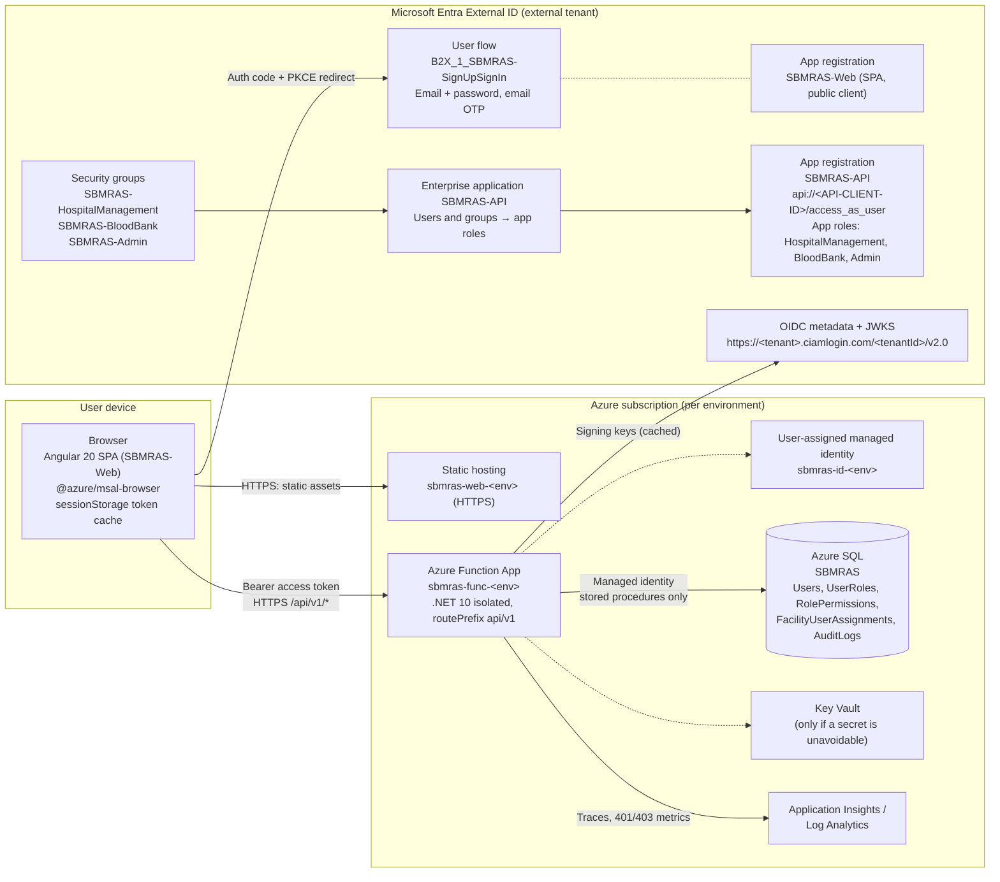

### 2.2 Trust boundaries

| # | Boundary | Crossing | Control |
|---|---|---|---|
| TB1 | Browser ↔ External ID | Credentials, authorization code, tokens | HTTPS, PKCE, exact redirect URIs, email verification, (prod) MFA / Conditional Access |
| TB2 | Browser ↔ Function App | Bearer access token, JSON | HTTPS, CORS allow-list, JWT validation, scope, permissions, facility scope, input validation |
| TB3 | Function App ↔ Azure SQL | Parameterized SP calls | Managed identity, least-privilege SQL principal (`EXECUTE`, read/write), network restriction |
| TB4 | Function App ↔ OIDC metadata | Public signing keys | HTTPS metadata only (`RequireHttps = true`), key cache/rollover |
| TB5 | Operators ↔ Entra / Azure portal | Group membership, role assignment, app settings | Privileged roles, PIM, access reviews, audit logs |

### 2.3 Component responsibilities

| Component | Authentication responsibility | Authorization responsibility |
|---|---|---|
| External ID user flow | Sign-up, email verification, password, sign-in, session | None (issues claims only) |
| `SBMRAS-Web` (Angular) | MSAL redirect login, silent token acquisition, sign-out | UX only: `authGuard`, `permissionGuard`, `*sbHasPermission`, menu from `GET me/menu` |
| `SBMRAS-API` (Functions) | JWT validation (`EntraTokenValidator`) | `RequestContextMiddleware` (roles sync, user context), `PermissionAuthorizationMiddleware` (`[RequirePermission]`) |
| Azure SQL | Identity record `(tid, oid)` | `RolePermissions`, `fn_UserHasPermission`, `fn_UserCanAccessFacility`, row-level visibility in SPs, append-only audit |

---

## 3. Identity architecture

### 3.1 Identity objects (summary)

| Object | Name / value | Purpose |
|---|---|---|
| Tenant | External tenant, e.g. `sbmrascustomers` (`https://sbmrascustomers.ciamlogin.com/`) | Holds public and institutional identities |
| User flow | `B2X_1_SBMRAS-SignUpSignIn` (portal name `SBMRAS-SignUpSignIn`) | Email + password self sign-up with email verification |
| App registration | `SBMRAS-Web` | Angular SPA, public client, auth code + PKCE |
| App registration | `SBMRAS-API` | Resource server; Application ID URI `api://<SBMRAS-API-CLIENT-ID>` |
| Delegated scope | `access_as_user` | Required in `scp` for every authenticated API call |
| App roles (on `SBMRAS-API`) | `HospitalManagement`, `BloodBank`, `Admin` | Emitted in `roles` claim of access token |
| Security groups | `SBMRAS-HospitalManagement`, `SBMRAS-BloodBank`, `SBMRAS-Admin` | Institutional membership; each assigned to one app role |
| DB roles | `PublicUser`, `HospitalManagement`, `BloodBank`, `Admin` | `Roles.RoleCode` == app-role value; drive permissions |

### 3.2 Identity resolution model

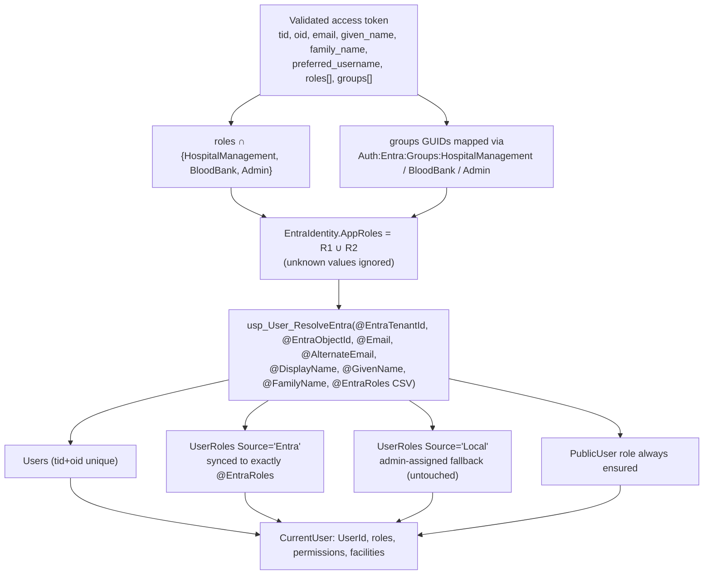

Effective role set = `{PublicUser}` ∪ Entra-sourced roles (this token) ∪ Local-sourced roles (admin fallback, see §9).
Effective permissions = union of `RolePermissions` for that role set (`vw_UserPermissions`).

### 3.3 User lifecycle states

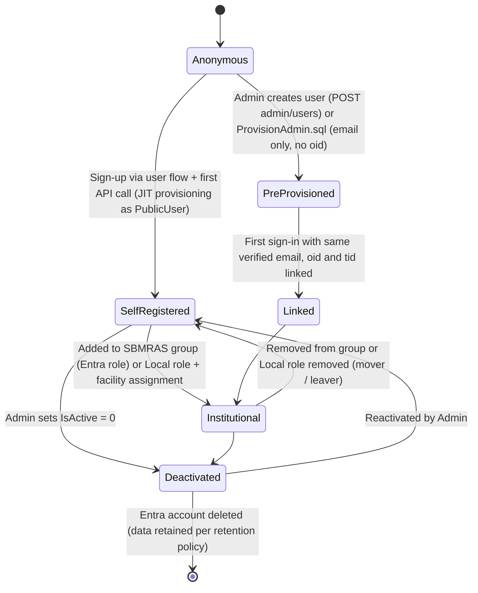

---

## 4. Authentication flows

### 4.1 End-to-end flow (requirement 9)

`User → Angular → External ID → Sign In/Up → Access token → Angular → SBMRAS API → Token validation → Group validation → Role
authorization → Business service`

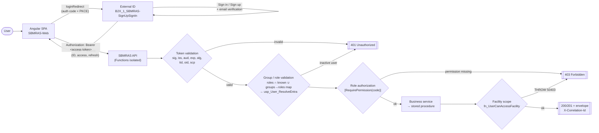

### 4.2 Bootstrap — runtime auth configuration

The SPA build is environment-agnostic for identity. On start-up it calls `GET /api/v1/auth/config` (anonymous) and receives:

```json
{
  "success": true,
  "message": "OK",
  "data": {
    "mode": "EntraId",
    "instance": "https://sbmrascustomers.ciamlogin.com/",
    "tenantId": "00000000-0000-0000-0000-000000000000",
    "spaClientId": "11111111-1111-1111-1111-111111111111",
    "apiScope": "api://22222222-2222-2222-2222-222222222222/access_as_user",
    "authority": "https://sbmrascustomers.ciamlogin.com/00000000-0000-0000-0000-000000000000",
    "userFlow": "B2X_1_SBMRAS-SignUpSignIn",
    "knownAuthority": "sbmrascustomers.ciamlogin.com"
  },
  "errors": []
}
```

> In External ID the user flow is **bound to the application** (User flow › Applications), not encoded in the authority URL as in
> Azure AD B2C. `userFlow` is returned for display/diagnostics; the authority is always `https://<tenant>.ciamlogin.com/<tenantId>`.

### 4.3 Sign-up (public self-registration with email verification)

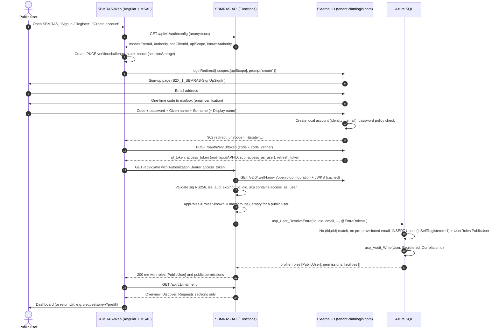

### 4.4 Sign-in (existing account, institutional user)

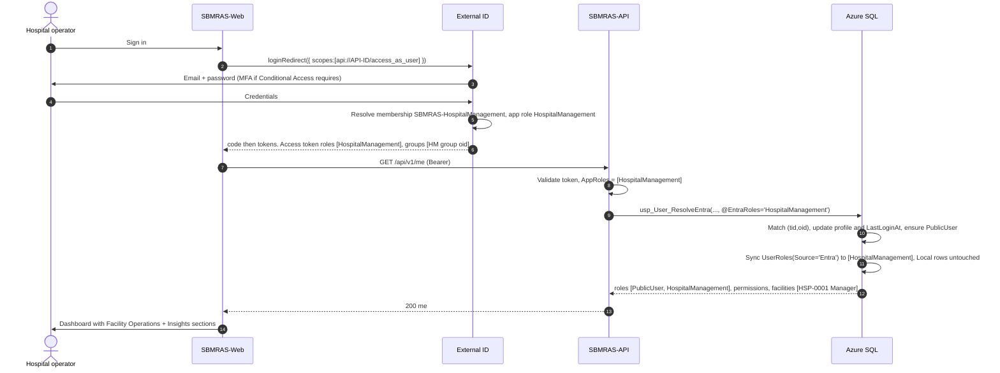

### 4.5 Authorized API call (business operation with facility scope)

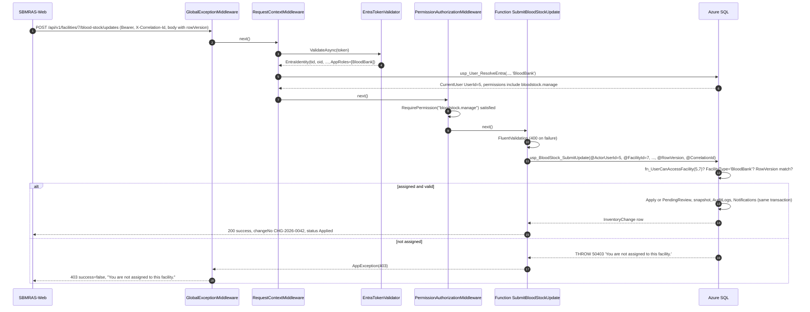

### 4.6 Token refresh (silent renewal)

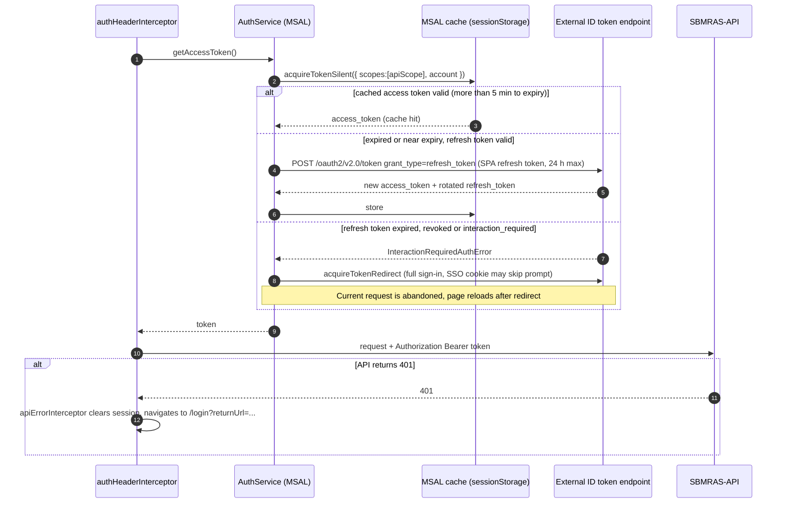

Notes: refresh tokens issued to SPA clients have a fixed 24-hour lifetime and are bound to the SPA origin. `sessionStorage` means
closing the tab ends the app session (the External ID SSO cookie may still allow a silent re-login).

### 4.7 Sign-out

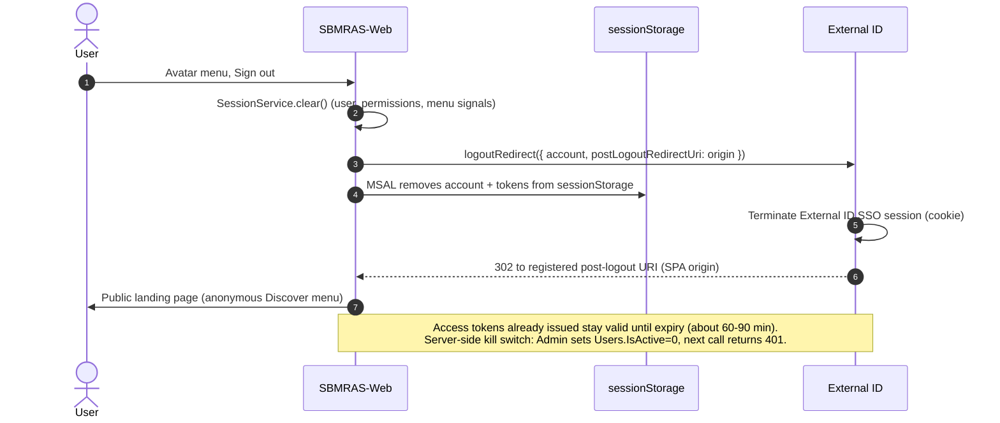

### 4.8 Unauthorized and forbidden paths

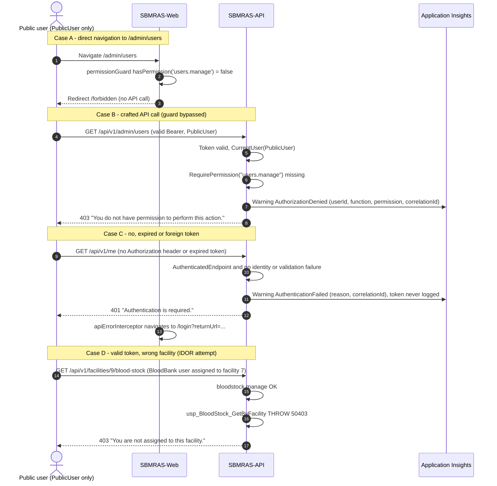

---

## 5. Authorization model

### 5.1 Personas and capabilities (requirement 8)

| Persona | Entra group | App role (`roles` claim) | DB roles | Capabilities |
|---|---|---|---|---|
| **Public user** | none | none | `PublicUser` | Public portal; search blood, medical resources and facilities (anonymous allowed); create and track **own** blood requests; cancel own request while `Submitted/UnderReview`; notifications; own dashboard |
| **Hospital management** | `SBMRAS-HospitalManagement` | `HospitalManagement` | `PublicUser` + `HospitalManagement` | Manage **assigned** hospital profile and medical-resource inventory; coordinate/approve blood requests; bulk import; verify changes; data quality; hospital reports and export |
| **Blood bank** | `SBMRAS-BloodBank` | `BloodBank` | `PublicUser` + `BloodBank` | Manage **assigned** blood bank stock; update/confirm availability; coordinate requests; bulk import; verify changes; data quality; blood-bank reports and export |
| **Admin** | `SBMRAS-Admin` | `Admin` | `PublicUser` + `Admin` | Full access (`data.viewall`); user and role management; facility verification; master data; system settings; audit management |

### 5.2 Role mapping (requirement 6 — 1:1)

| Entra security group | → App role on `SBMRAS-API` (value) | → `Roles.RoleCode` | `Roles.EntraGroupName` | `Auth:Entra:Groups:*` key |
|---|---|---|---|---|
| `SBMRAS-HospitalManagement` | `HospitalManagement` | `HospitalManagement` | `SBMRAS-HospitalManagement` | `Auth:Entra:Groups:HospitalManagement` = group object ID |
| `SBMRAS-BloodBank` | `BloodBank` | `BloodBank` | `SBMRAS-BloodBank` | `Auth:Entra:Groups:BloodBank` = group object ID |
| `SBMRAS-Admin` | `Admin` | `Admin` | `SBMRAS-Admin` | `Auth:Entra:Groups:Admin` = group object ID |
| *(none)* | *(none)* | `PublicUser` (always) | NULL | — |

Two independent signals reach the same DB role: the `roles` claim (primary contract, SDD §6.3) and the `groups` claim mapped through
configured object IDs (secondary). They are **unioned**; neither can grant a role that is not one of the three known values. Group
**names** are never trusted — only object IDs configured server-side.

### 5.3 Permission-code matrix (contract §3.4)

| Permission code | Module | PublicUser | HospitalManagement | BloodBank | Admin |
|---|---|:-:|:-:|:-:|:-:|
| `dashboard.view` | Overview | Y | Y | Y | Y |
| `search.view` | Discover | Y | Y | Y | Y |
| `requests.view` | Requests | Y | Y | Y | Y |
| `requests.create` | Requests | Y | Y | Y | Y |
| `requests.manage` (coordinate/approve/status) | Requests | | Y | Y | Y |
| `facilities.view` | Facilities | | Y | Y | Y |
| `facilities.manage` (edit assigned profile) | Facilities | | Y | Y | Y |
| `resources.manage` (medical resource inventory) | Facilities | | Y | | Y |
| `bloodstock.manage` | Facilities | | | Y | Y |
| `inventory.import` | Facilities | | Y | Y | Y |
| `inventory.verify` | Facilities | | Y | Y | Y |
| `dataquality.view` | Insights | | Y | Y | Y |
| `reports.view` | Insights | | Y | Y | Y |
| `reports.export` | Insights | | Y | Y | Y |
| `audit.view` | Insights | | | | Y |
| `notifications.view` | Common | Y | Y | Y | Y |
| `users.manage` | Admin | | | | Y |
| `roles.manage` | Admin | | | | Y |
| `facilities.verify` | Admin | | | | Y |
| `masterdata.manage` | Admin | | | | Y |
| `settings.manage` | Admin | | | | Y |
| `data.viewall` (all facilities/records) | Admin | | | | Y |

Because every institutional user also holds `PublicUser`, institutional users can also raise and track their own requests.
`PUT admin/roles/{id}/permissions` lets an Admin tune `RolePermissions`; the SP refuses to remove `users.manage` or `roles.manage`
from `Admin` (lock-out protection). Changes take effect on the **next API request** (permissions are resolved per request).

### 5.4 From app role to permission to data (three layers)

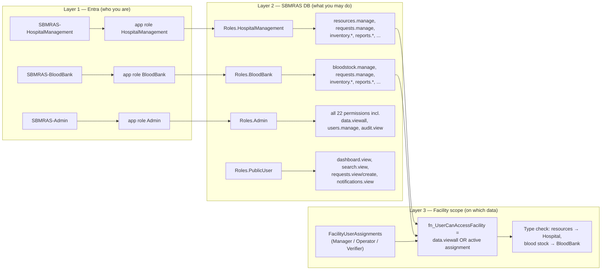

### 5.5 Facility scope rules (BR-08/BR-09)

| Rule | Enforcement |
|---|---|
| A HospitalManagement/BloodBank user can only read/write facilities with an **active** `FacilityUserAssignments` row | `fn_UserCanAccessFacility(@ActorUserId, @FacilityId)` in every facility-level SP → `THROW 50403` → HTTP 403 |
| Admin (`data.viewall`) can access all facilities | Same function returns 1 |
| Medical resources only on `FacilityType='Hospital'`; blood stock only on `'BloodBank'` | Type check in `usp_Resource_*` / `usp_BloodStock_*` → 50403 |
| Change decision: decider ≠ submitter unless Admin | `usp_Change_Decide` |
| Request visibility: owner, or `requests.manage` (scope=all only honoured with `requests.manage`); contact phone hidden otherwise | `usp_Request_Search`, `usp_Request_GetById` |
| Request status change to `Matched` requires matched facility accessible to the actor (unless Admin) | `usp_Request_ChangeStatus` |
| Holding the role without a facility assignment yields **empty lists and 403 on facility resources**, never "all" | `fn_UserCanAccessFacility` |

Facility assignments are **not** carried in Entra; they are maintained by Admins in **Administration › Users & Access**
(`PUT admin/users/{id}/facilities`).

### 5.6 Endpoint authorization catalogue (contract §6)

| Endpoint group | Attribute / permission | Scope check in SP |
|---|---|---|
| `GET auth/config`, `GET auth/dev-users` (404 unless DevHeader) | `[AllowAnonymousEndpoint]` | — |
| `GET public/lookups`, `public/stats`, `public/blood-availability`, `public/medical-resources`, `public/facilities` | `[AllowAnonymousEndpoint]` | Only Verified + active facilities; never requester data |
| `GET me`, `GET me/menu` | `[AuthenticatedEndpoint]` | Own context |
| `GET dashboard/*` | `dashboard.view` | Role-scoped (own / assigned / all) |
| `GET requests`, `GET requests/{id}`, `GET requests/{id}/matches` | `requests.view` | Owner or `requests.manage` |
| `POST requests`, `POST requests/{id}/cancel` | `requests.create` | Owner only for cancel; `Idempotency-Key` |
| `POST requests/{id}/status` | `requests.manage` | Matched facility accessible |
| `GET facilities`, `GET facilities/{id}`, `GET facilities/{id}/history` | `facilities.view` | Assigned or `data.viewall` |
| `PUT facilities/{id}` | `facilities.manage` | Assigned |
| `GET/POST facilities/{id}/resources[/updates]` | `resources.manage` | Assigned + Hospital |
| `GET/POST facilities/{id}/blood-stock[/updates, /confirm]` | `bloodstock.manage` | Assigned + BloodBank |
| `GET inventory-changes`, `POST inventory-changes/{id}/decision` | `inventory.verify` | Assigned; decider ≠ submitter |
| `GET/POST imports[...]` | `inventory.import` | Assigned |
| `GET/POST data-quality/*` | `dataquality.view` | Assigned / all |
| `GET reports`, `GET reports/{code}` / `.../export` | `reports.view` / `reports.export` | Assigned / all |
| `GET notifications*`, `POST notifications/*` | `notifications.view` | Own |
| `GET audit-logs` | `audit.view` | All (Admin) |
| `GET audit-logs/{entityType}/{entityId}` | `dashboard.view` | SP enforces entity visibility |
| `GET/POST/PUT admin/users*` | `users.manage` | — |
| `GET admin/roles`, `GET admin/permissions`, `PUT admin/roles/{id}/permissions` | `roles.manage` | Admin keeps users/roles.manage |
| `GET/POST/PUT admin/facilities*`, `POST admin/facilities/{id}/verify` | `facilities.verify` | — |
| `GET/POST admin/master-data/{type}` | `masterdata.manage` | Type allow-list |
| `GET/PUT admin/settings` | `settings.manage` | Type-validated |

### 5.7 Menu authorization (contract §7.3)

The menu is data-driven: `GET me/menu` → `usp_Me_GetMenu` returns only `MenuItems` whose `MenuPermissions` permission the user holds.
Anonymous users see the static **Discover** section. Resulting navigation per persona:

| Section | Items (permission) | Public | Hospital | Blood bank | Admin |
|---|---|:-:|:-:|:-:|:-:|
| Overview | Dashboard (`dashboard.view`) | ✔ | ✔ | ✔ | ✔ |
| Discover | Find Blood, Medical Resources, Facility Directory (`search.view`) | ✔ | ✔ | ✔ | ✔ |
| Requests | My Requests (`requests.view`), New Request (`requests.create`) | ✔ | ✔ | ✔ | ✔ |
| Requests | Request Coordination (`requests.manage`) | | ✔ | ✔ | ✔ |
| Facility Operations | My Facilities (`facilities.view`), Bulk Import (`inventory.import`), Change Verification (`inventory.verify`) | | ✔ | ✔ | ✔ |
| Facility Operations | Resource Inventory (`resources.manage`) | | ✔ | | ✔ |
| Facility Operations | Blood Stock (`bloodstock.manage`) | | | ✔ | ✔ |
| Insights | Data Quality (`dataquality.view`), Reports (`reports.view`) | | ✔ | ✔ | ✔ |
| Insights | Audit Explorer (`audit.view`) | | | | ✔ |
| Administration | Users & Access, Roles & Permissions, Facility Verification, Master Data, System Settings | | | | ✔ |

---

## 6. Authorization flow (API pipeline)

### 6.1 Middleware decision flow

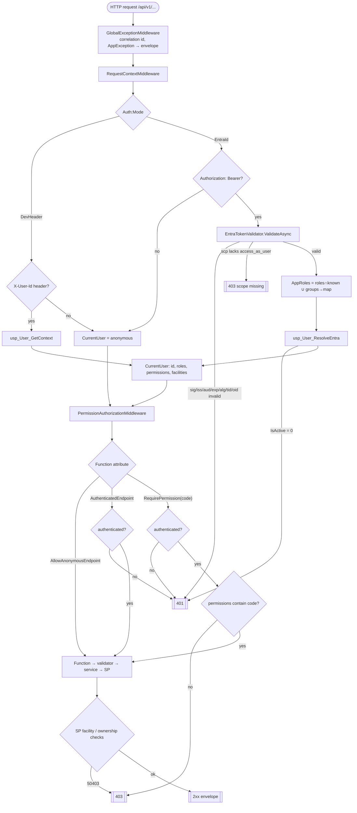

A token that fails validation is **always 401**, even on `[AllowAnonymousEndpoint]` functions — a caller presenting a bad token must
fix or drop it (the SPA interceptor never attaches tokens to `auth/config`).

### 6.2 401 vs 403 contract

| Situation | Status | Message (safe) | SPA behaviour |
|---|---|---|---|
| No token / no `X-User-Id` on a protected function | 401 | "Authentication is required." | Redirect `/login?returnUrl=` |
| Token malformed, > 16 KB, bad signature, expired, wrong issuer/audience/tenant, missing `oid`, non-RS256 | 401 | "The bearer token is invalid or could not be validated." | Redirect `/login` (MSAL silent renew first) |
| User row `IsActive = 0` | 401 | "Your account is inactive. Contact the administrator." | Sign-in page with message |
| Valid token but `scp` lacks `access_as_user` (RFC 6750 `insufficient_scope`) | 403 | "The required API scope is missing." | `/forbidden` |
| Authenticated, permission not held | 403 | "You do not have permission to perform this action." | Snackbar / `/forbidden` |
| Authenticated, not assigned to the facility / wrong facility type | 403 | "You are not assigned to this facility." | Inline error |
| Resource does not exist or is hidden from caller | 404 | "Not found." | Not-found state |

Every 401/403 response carries `X-Correlation-Id` and is logged (§8.11).

---

## 7. Access matrix

### 7.1 Business access matrix (requirement 10)

| Capability | Public | HospitalManagement | BloodBank | Admin | Enforced by |
|---|:-:|:-:|:-:|:-:|---|
| Registration | Yes | Yes | Yes | Yes | External ID user flow (self-service sign-up) |
| Login | Yes | Yes | Yes | Yes | External ID + `[AuthenticatedEndpoint] GET me` |
| Search Blood | Yes | Yes | Yes | Yes | `[AllowAnonymousEndpoint]` public search; `search.view` for menu |
| Create Blood Request | Yes | Yes | Yes | Yes | `requests.create` (sign-in required; PublicUser holds it) |
| Manage Hospital Data | No | Yes (assigned) | No | Yes | `facilities.manage` + `resources.manage` + facility scope + type = Hospital |
| Manage Blood Inventory | No | No | Yes (assigned) | Yes | `bloodstock.manage` + facility scope + type = BloodBank |
| User Management | No | No | No | Yes | `users.manage`, `roles.manage` |
| Reports | No | Yes (assigned) | Yes (assigned) | Yes (all) | `reports.view`, `reports.export` + scope |
| System Configuration | No | No | No | Yes | `settings.manage`, `masterdata.manage`, `facilities.verify` |

### 7.2 Detailed matrix (SDD §6.5)

| Feature | Public | HospitalManagement | BloodBank | Admin |
|---|---|---|---|---|
| Approve / coordinate requests | Own request view; cancel own | Hospital-scoped (`requests.manage`) | Blood-bank-scoped (`requests.manage`) | All |
| Data quality dashboard | Public freshness only | Assigned hospitals | Assigned blood banks | All facilities |
| Audit management | No | Entity timeline only where SP allows | Entity timeline only where SP allows | Full (`audit.view`) |
| Master data / system configuration | No | No | No | Yes |

---

## 8. Azure configuration

> Click-by-click portal steps are in [`deploy/entra-external-id-setup.md`](../deploy/entra-external-id-setup.md). This section is the
> **target state** that the runbook produces and the go-live review verifies.

### 8.1 User Flow Configuration

| Setting | Value | Notes |
|---|---|---|
| Flow type | Sign up and sign in | **Entra ID › External Identities › User flows** |
| Name | `SBMRAS-SignUpSignIn` → displayed/referenced as `B2X_1_SBMRAS-SignUpSignIn` | Config key `Auth:Entra:UserFlow` |
| Identity provider | **Email with password** | Email one-time passcode **not** used as the sign-in method |
| Email verification | Enforced on sign-up (one-time code sent to the email) | Built-in for email + password sign-up in External ID |
| User attributes collected | **Email Address** (always), **Given Name**, **Surname**, **Display Name** | Feed `given_name`, `family_name`, `name` claims |
| Applications | **SBMRAS-Web** added under *Usage › Applications* | Without this "Create account" does not appear; an app can be linked to **one** user flow only |
| Password policy | Tenant default (min 8 chars, 3 of 4 classes); smart lockout on by default | Do not weaken |
| Branding | Company branding: SBMRAS logo, banner, privacy & terms links | Users must recognise the legitimate page (anti-phishing) |
| Language | English (add others if required) | |
| Self-service password reset | Enabled ("Forgot password?" via email OTP) | **Authentication methods › Email OTP** enabled for SSPR |

**Public registration rule:** any person can sign up; sign-up never places a user in a security group and never assigns an app role.
Institutional access is granted only through §8.6.

### 8.2 App Registration Configuration

| Property | `SBMRAS-Web` | `SBMRAS-API` |
|---|---|---|
| Purpose | Angular SPA (public client) | Resource server for the Functions API |
| Supported account types | Accounts in this organizational directory only (the external tenant) | Same |
| Platform | **Single-page application** | None (no redirect URI) |
| Client secret / certificate | **None** (forbidden) | **None** (API only validates tokens) |
| Implicit grant (ID / access tokens) | **Off** (auth code + PKCE only) | n/a |
| Allow public client flows | No | No |
| Application ID URI | — | `api://<SBMRAS-API-CLIENT-ID>` |
| Exposed scope | — | `access_as_user` |
| App roles | — | `HospitalManagement`, `BloodBank`, `Admin` |
| `requestedAccessTokenVersion` | 2 | **2** (v2 issuer `https://<tenantId>.ciamlogin.com/<tenantId>/v2.0`) |
| Optional claims | ID token: `email`, `given_name`, `family_name`, `preferred_username` | Access token: `email`, `given_name`, `family_name`, `preferred_username`; groups claim (`SecurityGroup`) |
| Enterprise app "Assignment required?" | **No** (every public user must be able to sign in) | **No** (public users need tokens without a role); roles granted by group assignment |
| Owners | ≥ 2 named owners (no shared accounts) | ≥ 2 named owners |

Access-token claims are governed by the **resource** (`SBMRAS-API`) registration; ID-token claims by the **client** (`SBMRAS-Web`).
The API only ever sees the access token, so the API registration's optional claims are the ones that matter for authorization.

#### 8.2.1 Redirect URIs per environment (`SBMRAS-Web`, platform **SPA**)

The SPA uses `window.location.origin` as `redirectUri` and `postLogoutRedirectUri`. Register the **origin only** — no path, no trailing slash.

| Environment | SPA origin (redirect + post-logout URI) | API base URL (`environment*.ts`) | Function App CORS / `Cors:AllowedOrigins` |
|---|---|---|---|
| Local | `http://localhost:4400` | `/api/v1` (proxy → `http://127.0.0.1:7073`) | `http://localhost:4400` |
| Dev | `https://sbmras-web-dev.azurewebsites.net` | `https://sbmras-func-dev.azurewebsites.net/api/v1` | `https://sbmras-web-dev.azurewebsites.net` |
| Test | `https://sbmras-web-test.azurewebsites.net` | `https://sbmras-func-test.azurewebsites.net/api/v1` | `https://sbmras-web-test.azurewebsites.net` |
| Prod | `https://sbmras-web-prod.azurewebsites.net` and custom domain, e.g. `https://sbmras.example.org` | `https://sbmras-func-prod.azurewebsites.net/api/v1` | both prod origins only |

`http://localhost` URIs are permitted only on the **dev/test** registration. In production use a separate `SBMRAS-Web` registration
(or tenant) without localhost URIs. If Azure Static Web Apps is chosen instead of App Service, substitute the
`https://<name>.<region>.azurestaticapps.net` origin.

#### 8.2.2 Exposed API scope (`SBMRAS-API › Expose an API`)

| Field | Value |
|---|---|
| Application ID URI | `api://<SBMRAS-API-CLIENT-ID>` |
| Scope name | `access_as_user` |
| Full scope value | `api://<SBMRAS-API-CLIENT-ID>/access_as_user` |
| Who can consent | Admins and users (admin consent is pre-granted, so users are never prompted) |
| Admin consent display name | Access SBMRAS API as the signed-in user |
| Admin consent description | Allows SBMRAS Web to call the SBMRAS API on behalf of the signed-in user. |
| User consent display name | Access SBMRAS on your behalf |
| User consent description | Allows SBMRAS to search availability and manage your blood requests as you. |
| State | Enabled |
| Scope id (fixed) | `b12561bc-2e80-4943-b072-0e3f59f96337` |
| Authorized client applications | `SBMRAS-Web` client ID pre-authorized for `access_as_user` (no consent prompt) |

#### 8.2.3 App roles manifest (`SBMRAS-API › Manifest`, Microsoft Graph format)

The `id` values are **fixed** so dev/test/prod and Infrastructure-as-Code stay consistent. Keep them unless they clash in your tenant.
`allowedMemberTypes: ["User"]` is what the portal shows as **Users/Groups** and is required for assigning groups.

```json
{
  "api": {
    "requestedAccessTokenVersion": 2,
    "oauth2PermissionScopes": [
      {
        "id": "b12561bc-2e80-4943-b072-0e3f59f96337",
        "value": "access_as_user",
        "type": "User",
        "isEnabled": true,
        "adminConsentDisplayName": "Access SBMRAS API as the signed-in user",
        "adminConsentDescription": "Allows SBMRAS Web to call the SBMRAS API on behalf of the signed-in user.",
        "userConsentDisplayName": "Access SBMRAS on your behalf",
        "userConsentDescription": "Allows SBMRAS to search availability and manage your blood requests as you."
      }
    ],
    "preAuthorizedApplications": [
      {
        "appId": "<SBMRAS-WEB-CLIENT-ID>",
        "delegatedPermissionIds": [ "b12561bc-2e80-4943-b072-0e3f59f96337" ]
      }
    ]
  },
  "appRoles": [
    {
      "id": "e00c2ed0-e13c-404c-b3ab-300668ce411d",
      "value": "HospitalManagement",
      "displayName": "Hospital Management",
      "description": "Manage assigned hospital profile and medical resources, coordinate/approve blood requests, hospital reports.",
      "allowedMemberTypes": [ "User" ],
      "isEnabled": true
    },
    {
      "id": "d4f0a58f-62bd-43ae-bd71-50172441f559",
      "value": "BloodBank",
      "displayName": "Blood Bank",
      "description": "Manage assigned blood bank stock and availability, coordinate requests, blood bank reports.",
      "allowedMemberTypes": [ "User" ],
      "isEnabled": true
    },
    {
      "id": "efde6267-13b6-4a66-bd48-8ebb78f165a5",
      "value": "Admin",
      "displayName": "Administrator",
      "description": "Full SBMRAS administration: users, roles, facility verification, master data, settings, audit.",
      "allowedMemberTypes": [ "User" ],
      "isEnabled": true
    }
  ],
  "groupMembershipClaims": "SecurityGroup",
  "optionalClaims": {
    "accessToken": [
      { "name": "email", "essential": false, "additionalProperties": [] },
      { "name": "given_name", "essential": false, "additionalProperties": [] },
      { "name": "family_name", "essential": false, "additionalProperties": [] },
      { "name": "preferred_username", "essential": false, "additionalProperties": [] },
      { "name": "groups", "essential": false, "additionalProperties": [] }
    ],
    "idToken": [
      { "name": "groups", "essential": false, "additionalProperties": [] }
    ]
  }
}
```

> **Do not** add `"emit_as_roles"` to the `groups` optional claim (portal: "Emit groups as role claims"). When groups are emitted
> as roles, Entra puts group object IDs in the `roles` claim **instead of** the assigned app-role values, which would silently remove
> `HospitalManagement`/`BloodBank`/`Admin` from the token. SBMRAS maps group IDs itself (`Auth:Entra:Groups:*`).

Changing an app role `value` is a **breaking change** (it equals `Roles.RoleCode`). To retire a role: set `isEnabled: false`, save,
then remove it in a later change.

### 8.3 API Permission Configuration

| Client | API | Permission | Type | Admin consent |
|---|---|---|---|---|
| `SBMRAS-Web` | `SBMRAS-API` (My APIs) | `access_as_user` | Delegated | **Granted** for tenant |
| `SBMRAS-Web` | Microsoft Graph | `openid` | Delegated | Granted |
| `SBMRAS-Web` | Microsoft Graph | `offline_access` | Delegated | Granted (refresh tokens) |
| `SBMRAS-Web` | Microsoft Graph | `email`, `profile` | Delegated | Granted (added by the optional-claim prompt) |
| `SBMRAS-API` | Microsoft Graph | `email`, `profile` | Delegated | Granted (added by the optional-claim prompt; needed for email/name claims) |
| `SBMRAS-API` | Microsoft Graph | *no application permissions* | — | The API never calls Graph |

Rules: no `User.Read.All`, `Directory.Read.All` or `GroupMember.Read.All` application permissions (would only be needed to resolve
group overage, which SBMRAS deliberately avoids — §8.4.3). Remove unused permissions before go-live.

### 8.4 Token Claim Configuration

#### 8.4.1 Required claims in the **access token** (what the API reads)

| Claim | Source | Used for | If missing |
|---|---|---|---|
| `iss` | Platform | Issuer validation | 401 |
| `aud` | Platform (`api://<API-ID>` or API client ID) | Audience validation | 401 |
| `exp`, `nbf`, `iat` | Platform | Lifetime (2-min clock skew) | 401 |
| `tid` | Platform | Must equal `Auth:Entra:TenantId` | 401 |
| `oid` | Platform | Stable user key `Users.EntraObjectId` | 401 |
| `scp` | Platform | Must contain `access_as_user` | 403 |
| `roles` | App-role assignment (via group) | Primary institutional role signal | No institutional role (PublicUser only) |
| `groups` | `groupMembershipClaims = SecurityGroup` | Secondary role signal via `Auth:Entra:Groups:*` | Ignored |
| `email` | Optional claim | Profile; linking pre-provisioned users | Falls back to `preferred_username`; without any email, the user is still keyed by oid but email linking is skipped |
| `given_name`, `family_name` | Optional claims (user-flow attributes) | Profile; display-name fallback | Display name from `name` |
| `preferred_username` | Optional claim | Alternate email | Ignored |
| `name` | Platform (Display Name attribute) | `DisplayName` | Built from given/family name |

#### 8.4.2 Example decoded access token (institutional user)

```json
{
  "aud": "api://22222222-2222-2222-2222-222222222222",
  "iss": "https://00000000-0000-0000-0000-000000000000.ciamlogin.com/00000000-0000-0000-0000-000000000000/v2.0",
  "iat": 1795280000, "nbf": 1795280000, "exp": 1795283900,
  "azp": "11111111-1111-1111-1111-111111111111",
  "tid": "00000000-0000-0000-0000-000000000000",
  "oid": "8f1c7b2e-5a4d-4c39-9e61-3b2a7d9c0f10",
  "sub": "Qm9vZ1...",
  "scp": "access_as_user",
  "roles": [ "BloodBank" ],
  "groups": [ "<SBMRAS-BloodBank group object id>" ],
  "email": "operator.bbk1@example.org",
  "given_name": "Kiran",
  "family_name": "Reddy",
  "preferred_username": "operator.bbk1@example.org",
  "name": "Kiran Reddy",
  "ver": "2.0"
}
```

A public user's token is identical except it has **no** `roles` and **no** `groups` claim.

#### 8.4.3 Group overage handling

| Condition | Token content | SBMRAS behaviour |
|---|---|---|
| ≤ 200 groups (JWT) | `groups: [ ... ]` | Mapped via `Auth:Entra:Groups:*` |
| > 200 groups | No `groups`; `_claim_names` / `_claim_sources` instead | **Ignored**. No Graph call. Role comes from the `roles` claim (app roles are not subject to overage) and Local DB roles |
| `groups` omitted by the tenant (External ID capability) | No `groups` claim | Same as overage (§9) |
| Unknown group IDs | Present but not mapped | Ignored |

Hardening option: configure the groups claim as **"Groups assigned to the application"** (`groupMembershipClaims: "ApplicationGroup"`)
so only the three SBMRAS groups can ever appear — this eliminates overage. Use `SecurityGroup` (as required) unless overage is
observed in testing; record the decision.

### 8.5 Security Group Configuration

| Group name | Type | Membership | Description | Owners | Assigned app role |
|---|---|---|---|---|---|
| `SBMRAS-HospitalManagement` | Security, **Assigned** | Hospital staff onboarded by Admin | SBMRAS hospital management operators | SBMRAS Admin lead + deputy | `HospitalManagement` |
| `SBMRAS-BloodBank` | Security, **Assigned** | Blood bank staff onboarded by Admin | SBMRAS blood bank operators | SBMRAS Admin lead + deputy | `BloodBank` |
| `SBMRAS-Admin` | Security, **Assigned** | ≤ 5 named administrators | SBMRAS platform administrators | Tenant Global Admin / IAM owner | `Admin` |

Rules:

- **Assigned** membership only (no dynamic rules on self-asserted attributes such as email domain or job title).
- No nested groups (group-to-app-role assignment does not cascade through nesting).
- Record each group's **Object ID** in the environment's GitHub variables (`ENTRA_GROUP_*_ID`) → `Auth:Entra:Groups:*`.
- Public users are never members of any SBMRAS group.
- A user should be in **one** institutional group; dual membership (Hospital + BloodBank) requires documented approval.

### 8.6 Role Assignment Process

#### 8.6.1 Assign groups to app roles (Enterprise Application)

**Entra ID › Enterprise applications › SBMRAS-API › Users and groups › Add user/group**:

| Group | Select a role |
|---|---|
| `SBMRAS-HospitalManagement` | Hospital Management |
| `SBMRAS-BloodBank` | Blood Bank |
| `SBMRAS-Admin` | Administrator |

Assignment is on the **API** enterprise application because the access token audience is `SBMRAS-API`; its `roles` claim is built
from assignments on that service principal. Keep **Assignment required = No** so public users still receive tokens.

#### 8.6.2 Joiner / mover / leaver

```mermaid
flowchart TD
    subgraph Joiner
        J1["Staff self-registers via SBMRAS sign-up<br/>(or Admin pre-creates user: POST admin/users)"] --> J2["Facility manager raises access request<br/>(name, email, facility code, role, justification)"]
        J2 --> J3{"Admin verifies identity<br/>and facility (Verified, active)"}
        J3 -- reject --> JX[Record rejection]
        J3 -- approve --> J4["Entra: add user to SBMRAS-HospitalManagement<br/>or SBMRAS-BloodBank"]
        J4 --> J5["SBMRAS Admin, Users & Access:<br/>assign facility (Manager/Operator/Verifier)"]
        J5 --> J6["User signs out and in, roles claim,<br/>usp_User_ResolveEntra syncs UserRoles(Entra)"]
        J6 --> J7[Verify menu + audit entry]
    end
    subgraph Mover
        M1[Facility or role change approved] --> M2[Entra: move between groups]
        M2 --> M3[SBMRAS: end old facility assignment, add new]
        M3 --> M4["Next token (about 90 min max) reflects new role"]
    end
    subgraph Leaver
        L1[Departure notified] --> L2["SBMRAS Admin: set IsActive = 0<br/>(immediate 401 on next call)"]
        L2 --> L3[Entra: remove from SBMRAS groups]
        L3 --> L4[SBMRAS: end facility assignments, remove Local roles]
        L4 --> L5["Entra: Revoke sessions<br/>delete or block account if required"]
    end
```

| Step | System | Actor | Evidence |
|---|---|---|---|
| Access request | Ticket / email (outside SBMRAS) | Facility manager | Request ID |
| Group membership | Entra admin center | IAM admin (Groups Administrator / group owner) | Entra audit log "Add member to group" |
| Facility assignment | SBMRAS **Administration › Users & Access** (`PUT admin/users/{id}/facilities`) | SBMRAS Admin | `AuditLogs` |
| Role sync | Automatic on next API call (`usp_User_ResolveEntra`) | System | `UserRoles.Source='Entra'`, `AuditLogs` |
| Deactivation | SBMRAS (`POST admin/users/{id}/status`) | SBMRAS Admin | `AuditLogs` |
| Session revocation | Entra › Users › *user* › Revoke sessions | IAM admin | Entra audit log |

Latency: role changes in Entra appear in the **next access token** (default lifetime ~60–90 min, or immediately after sign-out/in).
For immediate removal, deactivate the user in SBMRAS **and** remove the group membership.

#### 8.6.3 First administrator (bootstrap) and break-glass

- Run `SBMRAS.Infrastructure\SQL\Deployment\ProvisionAdmin.sql` with the admin's email (Local `Admin` role, linked on first sign-in by
  verified email), **and** add the person to `SBMRAS-Admin`.
- Maintain **two** break-glass identities (§14.8).

### 8.7 Angular MSAL Configuration

The SPA discovers its identity settings at runtime (`GET auth/config`) so one bundle serves every environment. Package:
`@azure/msal-browser` (redirect flow, PKCE built in).

#### 8.7.1 Environment files (`SBMRAS.Web/src/environments`)

```ts
// environment.ts (local)
export const environment = {
  production: false,
  name: 'local',
  apiBaseUrl: '/api/v1', // proxy.conf.json: /api → http://127.0.0.1:7073
};

// environment.prod.ts
export const environment = {
  production: true,
  name: 'prod',
  apiBaseUrl: 'https://sbmras-func-prod.azurewebsites.net/api/v1',
};
```

No client IDs, tenant IDs or secrets are compiled into the bundle; they come from `auth/config`.

#### 8.7.2 Auth model (`core/models/auth.models.ts`)

```ts
export type AuthMode = 'DevHeader' | 'EntraId';

export interface AuthConfig {
  mode: AuthMode;
  instance: string | null;       // https://<tenant>.ciamlogin.com/
  tenantId: string | null;
  spaClientId: string | null;    // SBMRAS-Web
  apiScope: string | null;       // api://<SBMRAS-API-CLIENT-ID>/access_as_user
  authority: string | null;      // https://<tenant>.ciamlogin.com/<tenantId>
  userFlow: string | null;       // B2X_1_SBMRAS-SignUpSignIn
  knownAuthority: string | null; // <tenant>.ciamlogin.com
}
```

#### 8.7.3 Auth service (`core/services/auth.service.ts`, essential parts)

```ts
import { HttpClient, HttpContext } from '@angular/common/http';
import { Injectable, computed, inject, signal } from '@angular/core';
import type { AccountInfo, IPublicClientApplication } from '@azure/msal-browser';
import { firstValueFrom, map, timeout } from 'rxjs';

@Injectable({ providedIn: 'root' })
export class AuthService {
  private readonly http = inject(HttpClient);
  private readonly config = signal<AuthConfig | null>(null);
  private msal: IPublicClientApplication | null = null;

  readonly isEntra = computed(() => this.config()?.mode === 'EntraId');

  get account(): AccountInfo | null { return this.msal?.getActiveAccount() ?? null; }
  get scopes(): string[] { const s = this.config()?.apiScope; return s ? [s] : []; }

  /** App initializer: GET auth/config, then initialise MSAL in EntraId mode. */
  async initialize(): Promise<void> {
    const cfg = await firstValueFrom(this.http
      .get<ApiResponse<AuthConfig>>('auth/config', { context: new HttpContext().set(SKIP_ERROR_TOAST, true) })
      .pipe(timeout(15000), map(r => r.data)));
    this.config.set(cfg);
    if (cfg?.mode === 'EntraId') await this.initializeMsal(cfg);
  }

  private async initializeMsal(cfg: AuthConfig): Promise<void> {
    const { PublicClientApplication } = await import('@azure/msal-browser');
    // https://<tenant>.ciamlogin.com/<tenantId>
    const authority = cfg.authority ?? `${cfg.instance!.replace(/\/?$/, '/')}${cfg.tenantId}`;
    const origin = window.location.origin; // http://localhost:4400 | https://sbmras-web-<env>.azurewebsites.net
    const app = new PublicClientApplication({
      auth: {
        clientId: cfg.spaClientId!,                                          // SBMRAS-Web
        authority,
        knownAuthorities: [cfg.knownAuthority ?? new URL(authority).host],   // ciamlogin.com is not in MSAL's default list
        redirectUri: origin,
        postLogoutRedirectUri: origin,
        navigateToLoginRequestUrl: false,                                     // SBMRAS routes to returnUrl itself
      },
      cache: { cacheLocation: 'sessionStorage' },                             // never localStorage
    });
    await app.initialize();
    const result = await app.handleRedirectPromise();
    app.setActiveAccount(result?.account ?? app.getActiveAccount() ?? app.getAllAccounts()[0] ?? null);
    this.msal = app;
  }

  signIn(): Promise<void> { return this.msal!.loginRedirect({ scopes: this.scopes }); }

  /** Opens the External ID sign-up page directly (B2X_1_SBMRAS-SignUpSignIn: email + password + email OTP). */
  signUp(): Promise<void> { return this.msal!.loginRedirect({ scopes: this.scopes, prompt: 'create' }); }

  async getAccessToken(): Promise<string | null> {
    const account = this.account;
    if (!this.msal || !account) return null;
    const request = { scopes: this.scopes, account };
    try {
      return (await this.msal.acquireTokenSilent(request)).accessToken; // cache → refresh token → hidden iframe
    } catch (error) {
      const { InteractionRequiredAuthError } = await import('@azure/msal-browser');
      if (error instanceof InteractionRequiredAuthError) await this.msal.acquireTokenRedirect(request);
      return null;
    }
  }

  async signOut(): Promise<void> {
    const account = this.account;
    if (this.msal && account) await this.msal.logoutRedirect({ account });
  }
}
```

Effective configuration when running locally against a real tenant:

```ts
// PublicClientApplication configuration
{
  auth: {
    clientId: '<SBMRAS-WEB-CLIENT-ID>',
    authority: 'https://sbmrascustomers.ciamlogin.com/<TENANT-ID>',
    knownAuthorities: ['sbmrascustomers.ciamlogin.com'],
    redirectUri: 'http://localhost:4400',
    postLogoutRedirectUri: 'http://localhost:4400',
  },
  cache: { cacheLocation: 'sessionStorage' },
}
// token request
{ scopes: ['api://<SBMRAS-API-CLIENT-ID>/access_as_user'] }
```

#### 8.7.4 Interceptor (`core/interceptors/api.interceptors.ts`)

```ts
/** Adds identity only to SBMRAS API calls: Bearer (EntraId) or X-User-Id (DevHeader), plus X-Correlation-Id. */
export const authHeaderInterceptor: HttpInterceptorFn = (req, next) => {
  if (!req.url.startsWith(environment.apiBaseUrl)) return next(req);       // never leak tokens to other origins
  const headers: Record<string, string> = { 'X-Correlation-Id': crypto.randomUUID() };
  if (req.url.endsWith('/auth/config')) return next(req.clone({ setHeaders: headers })); // anonymous bootstrap

  const auth = inject(AuthService);
  if (auth.isEntra()) {
    return from(auth.getAccessToken()).pipe(
      switchMap(token => next(req.clone({
        setHeaders: token ? { ...headers, Authorization: `Bearer ${token}` } : headers,
      }))),
    );
  }
  const userId = inject(SessionService).userId;                            // DevHeader (local only)
  if (userId) headers['X-User-Id'] = String(userId);
  return next(req.clone({ setHeaders: headers }));
};
```

Interceptor order (`app.config.ts`): `apiBaseUrlInterceptor` → `authHeaderInterceptor` → `loadingInterceptor` → `apiErrorInterceptor`.
`apiErrorInterceptor`: **401** → clear `SessionService`, navigate `/login?returnUrl=<current>`; **403** → snackbar / `/forbidden`.

#### 8.7.5 Guards

```ts
export const authGuard: CanActivateFn = (_route, state) =>
  inject(SessionService).isAuthenticated()
    ? true
    : inject(Router).createUrlTree(['/login'], { queryParams: { returnUrl: state.url } });

export const permissionGuard: CanActivateFn = route => {
  const code = route.data?.['permission'] as string | undefined;
  return !code || inject(SessionService).hasPermission(code) ? true : inject(Router).createUrlTree(['/forbidden']);
};
```

Guards read permissions from `GET me` (server-computed), **never** from token claims parsed in the browser.

#### 8.7.6 Content Security Policy (static host)

`connect-src 'self' https://sbmras-func-<env>.azurewebsites.net https://*.ciamlogin.com; frame-src https://*.ciamlogin.com;
form-action 'self' https://*.ciamlogin.com; frame-ancestors 'none'` (set in `public/web.config` / hosting headers).

### 8.8 Azure Function Authentication Configuration

#### 8.8.1 Configuration keys (contract §2)

| Key (local `:`; Azure app setting `__`) | Local value | Azure value | Notes |
|---|---|---|---|
| `Auth:Mode` | `DevHeader` | `EntraId` | Anything else → startup failure. **DevHeader must never be reachable from the internet.** |
| `Auth:Entra:Instance` | `https://<tenant-subdomain>.ciamlogin.com/` | same | Authority host |
| `Auth:Entra:TenantId` | external tenant GUID | same | Must match `tid` |
| `Auth:Entra:ClientId` | `SBMRAS-API` client ID | same | Valid audience |
| `Auth:Entra:SpaClientId` | `SBMRAS-Web` client ID | same | Returned by `auth/config` |
| `Auth:Entra:Audience` | `api://<API-CLIENT-ID>` | same | Blank → defaults to `api://<ClientId>` |
| `Auth:Entra:RequiredScope` | `access_as_user` | same | Checked against `scp` |
| `Auth:Entra:UserFlow` | `B2X_1_SBMRAS-SignUpSignIn` | same | Informational (returned by `auth/config`) |
| `Auth:Entra:Groups:HospitalManagement` | group object ID or blank | same | Blank = not mapped |
| `Auth:Entra:Groups:BloodBank` | group object ID or blank | same | |
| `Auth:Entra:Groups:Admin` | group object ID or blank | same | |
| `Cors:AllowedOrigins` | `http://localhost:4400` | exact SPA origin(s), comma-separated | No `*` |

Local `SBMRAS.API/local.settings.json` (git-ignored; Functions host on port 7073):

```json
{
  "IsEncrypted": false,
  "Values": {
    "FUNCTIONS_WORKER_RUNTIME": "dotnet-isolated",
    "AzureWebJobsStorage": "",
    "SqlConnectionString": "Server=localhost;Database=SBMRAS;Trusted_Connection=True;TrustServerCertificate=True;Encrypt=False",
    "Auth:Mode": "EntraId",
    "Auth:Entra:Instance": "https://sbmrascustomers.ciamlogin.com/",
    "Auth:Entra:TenantId": "<TENANT-ID>",
    "Auth:Entra:ClientId": "<SBMRAS-API-CLIENT-ID>",
    "Auth:Entra:SpaClientId": "<SBMRAS-WEB-CLIENT-ID>",
    "Auth:Entra:Audience": "api://<SBMRAS-API-CLIENT-ID>",
    "Auth:Entra:RequiredScope": "access_as_user",
    "Auth:Entra:UserFlow": "B2X_1_SBMRAS-SignUpSignIn",
    "Auth:Entra:Groups:HospitalManagement": "<GROUP-OBJECT-ID>",
    "Auth:Entra:Groups:BloodBank": "<GROUP-OBJECT-ID>",
    "Auth:Entra:Groups:Admin": "<GROUP-OBJECT-ID>",
    "Cors:AllowedOrigins": "http://localhost:4400"
  },
  "Host": { "LocalHttpPort": 7073, "CORS": "http://localhost:4400" }
}
```

(The committed default is `Auth:Mode=DevHeader`; switch to `EntraId` only when testing against a real tenant.)

Startup validation (fail fast): in `EntraId` mode `TenantId`, `ClientId`, `SpaClientId` must be GUIDs, `Instance` must be `https://`,
every non-blank `Groups:*` value must be a GUID.

#### 8.8.2 Token validation (`SBMRAS.Infrastructure/Auth/EntraTokenValidator.cs`)

```csharp
public sealed record EntraIdentity(Guid TenantId, Guid ObjectId, string? Email, string? AlternateEmail,
    string? DisplayName, string? GivenName, string? FamilyName, string[] AppRoles);

// Metadata: {Instance}{TenantId}/v2.0/.well-known/openid-configuration  (HTTPS only, keys cached + auto-refreshed)
var result = await _handler.ValidateTokenAsync(token, new TokenValidationParameters
{
    ValidateIssuer = true,
    // ciamlogin issues https://<tenantId>.ciamlogin.com/<tenantId>/v2.0, which differs from the authority host,
    // so the issuer advertised by the tenant metadata is accepted in addition to {Authority}/v2.0.
    ValidIssuers = [$"{authority}/v2.0", metadata.Issuer],
    ValidateAudience = true,
    ValidAudiences = [options.Audience, options.ClientId],   // api://<API-ID> or <API-ID>
    ValidateIssuerSigningKey = true,
    IssuerSigningKeys = metadata.SigningKeys,
    RequireSignedTokens = true,
    RequireExpirationTime = true,
    ValidateLifetime = true,
    ClockSkew = TimeSpan.FromMinutes(2),
    ValidAlgorithms = [SecurityAlgorithms.RsaSha256],
});
// Post-validation checks
//  token length ≤ 16 KB                                              → else 401
//  tid == Auth:Entra:TenantId and oid is a non-empty GUID            → else 401
//  scp (space separated) contains Auth:Entra:RequiredScope           → else 403 "The required API scope is missing."

private static readonly string[] KnownRoles = ["HospitalManagement", "BloodBank", "Admin"];

string[] appRoles = identity.FindAll("roles").Select(c => c.Value)
        .Where(v => KnownRoles.Contains(v, StringComparer.Ordinal))                    // exact app-role values only
    .Union(identity.FindAll("groups").Select(c => c.Value)
        .Select(g => options.GroupRoleMap.TryGetValue(g, out var role) ? role : null)    // object id → role (from Groups:*)
        .OfType<string>())
    .Distinct(StringComparer.Ordinal).ToArray();
// _claim_names / _claim_sources (overage) are ignored: absence never grants a role.
```

#### 8.8.3 Request context and DB role sync (`SBMRAS.API/Middleware/RequestContextMiddleware.cs`)

```csharp
if (auth.IsEntra && TryGetBearer(request, out var token))
{
    EntraIdentity id = await _validator.ValidateAsync(token, ct);                     // 401/403 on failure
    CurrentUser user = await _securityRepository.ResolveEntraAsync(id, correlationId, ct);
    // EXEC dbo.usp_User_ResolveEntra @EntraTenantId, @EntraObjectId, @Email, @AlternateEmail,
    //      @DisplayName, @GivenName, @FamilyName, @EntraRoles = string.Join(',', id.AppRoles)
    if (!user.IsActive) throw AppException.Unauthorized("Your account is inactive. Contact the administrator.");
    context.Items[CurrentUser.ItemKey] = user;
}
```

`usp_User_ResolveEntra` (in `03_StoredProcedures_Security.sql`) — logic:

```sql
-- 1. Match by (EntraTenantId, EntraObjectId) → update names/email, LastLoginAt
-- 2. Else match a pre-provisioned user by Email WHERE EntraObjectId IS NULL → link tid/oid
-- 3. Else INSERT Users (IsSelfRegistered = 1, IsActive = 1)                         -- public self-registration
-- 4. Ensure UserRoles(PublicUser)
-- 5. Parse @EntraRoles CSV; keep only RoleCode IN ('HospitalManagement','BloodBank','Admin')
--    DELETE UserRoles WHERE Source = 'Entra' AND RoleCode NOT IN (@EntraRoles)
--    INSERT UserRoles(..., Source = 'Entra') for new ones                            -- Local rows untouched (SDD 6.3 fallback)
-- 6. Audit role changes (OldValues/NewValues) in the same transaction
-- 7. Return profile, roles, permissions, facilities (same result sets as usp_User_GetContext)
```

Concurrency: the filtered unique index on `(EntraTenantId, EntraObjectId)` plus an `UPDLOCK, HOLDLOCK` lookup prevents duplicate
users when the SPA fires parallel first calls.

#### 8.8.4 Permission middleware (`SBMRAS.API/Authorization`)

```csharp
[AttributeUsage(AttributeTargets.Method)]
public sealed class RequirePermissionAttribute(string code) : Attribute { public string Code { get; } = code; }
[AttributeUsage(AttributeTargets.Method)] public sealed class AllowAnonymousEndpointAttribute : Attribute;
[AttributeUsage(AttributeTargets.Method)] public sealed class AuthenticatedEndpointAttribute : Attribute;

// Usage
[Function("SubmitBloodStockUpdate")]
[RequirePermission(Permissions.BloodStockManage)]          // "bloodstock.manage"
public async Task<HttpResponseData> SubmitBloodStockUpdate(
    [HttpTrigger(AuthorizationLevel.Anonymous, "post", Route = "facilities/{id:int}/blood-stock/updates")] HttpRequestData req,
    int id) { ... }

// PermissionAuthorizationMiddleware
//  Startup: reflect over all [Function] methods with an HttpTrigger; throw InvalidOperationException
//           if any has none of [RequirePermission], [AllowAnonymousEndpoint], [AuthenticatedEndpoint].
//  Per request:
//    AllowAnonymousEndpoint  → continue
//    AuthenticatedEndpoint   → CurrentUser ? continue : 401
//    RequirePermission(code) → CurrentUser ? (permissions contain code ? continue : 403) : 401
```

`AuthorizationLevel.Anonymous` is used on triggers because authorization is done by the middleware; **function keys are not an
authorization mechanism** for SBMRAS. A unit test asserts every HTTP function is annotated.

#### 8.8.5 Facility scope in stored procedures

```sql
IF dbo.fn_UserCanAccessFacility(@ActorUserId, @FacilityId) = 0
    THROW 50403, 'You are not assigned to this facility.', 1;
IF NOT EXISTS (SELECT 1 FROM dbo.Facilities WHERE FacilityId = @FacilityId AND FacilityType = N'BloodBank')
    THROW 50403, 'You are not assigned to this facility.', 1;

-- fn_UserCanAccessFacility = fn_UserHasPermission(@UserId, 'data.viewall')
--   OR EXISTS (active FacilityUserAssignments row for @UserId, @FacilityId)
```

`GlobalExceptionMiddleware` maps SQL `50403` → 403, `50400` → 400, `50404` → 404, `50001–50099`/`50409` → 409; anything else → 500
generic with `X-Correlation-Id`.

#### 8.8.6 DevHeader mode (local only)

`Auth:Mode=DevHeader` trusts `X-User-Id` chosen from `GET auth/dev-users`. It exists only for local development and automated tests.
Controls: IaC/deploy pipelines **hard-code `Auth__Mode=EntraId`**; the `deploy-api` smoke test fails if `GET auth/config` returns
`DevHeader`; `GET auth/dev-users` returns 404 in `EntraId` mode.

### 8.9 Deployment Configuration

| Resource (per env) | Name pattern | Identity-relevant configuration |
|---|---|---|
| External ID tenant | `sbmrascustomers` (dev/test); separate tenant recommended for prod | User flow, apps, groups, role assignment |
| Resource group | `rg-sbmras-<env>` | GitHub deploy identity = Contributor (scoped) |
| User-assigned MI | `sbmras-id-<env>` | Function runtime identity: SQL `db_datareader`, `db_datawriter`, `EXECUTE` (`Deployment\GrantRuntimeIdentity.sql`) |
| Function App | `sbmras-func-<env>` | `Auth__*`, `Cors__AllowedOrigins`, platform CORS = SPA origin(s), HTTPS only, TLS ≥ 1.2, FTP disabled, App Service Authentication (Easy Auth) **off** (the app validates tokens itself) |
| Web host | `sbmras-web-<env>` | HTTPS only, CSP (§8.7.6), SPA rewrite |
| Azure SQL | `sbmras-sql-<env>` / `SBMRAS` | Entra-only auth preferred; MI connection string `Authentication=Active Directory Managed Identity` |
| Key Vault | `sbmras-kv-<env>` | Only if a secret cannot be removed; Function reads via MI + Key Vault references |
| Application Insights | `sbmras-appi-<env>` | 401/403 alerts (§8.11) |

Function App application settings:

```text
Auth__Mode=EntraId
Auth__Entra__Instance=https://sbmrascustomers.ciamlogin.com/
Auth__Entra__TenantId=<TENANT-ID>
Auth__Entra__ClientId=<SBMRAS-API-CLIENT-ID>
Auth__Entra__SpaClientId=<SBMRAS-WEB-CLIENT-ID>
Auth__Entra__Audience=api://<SBMRAS-API-CLIENT-ID>
Auth__Entra__RequiredScope=access_as_user
Auth__Entra__UserFlow=B2X_1_SBMRAS-SignUpSignIn
Auth__Entra__Groups__HospitalManagement=<GROUP-OBJECT-ID>
Auth__Entra__Groups__BloodBank=<GROUP-OBJECT-ID>
Auth__Entra__Groups__Admin=<GROUP-OBJECT-ID>
Cors__AllowedOrigins=https://sbmras-web-<env>.azurewebsites.net
SqlConnectionString=Server=tcp:sbmras-sql-<env>.database.windows.net,1433;Initial Catalog=SBMRAS;Authentication=Active Directory Managed Identity;User Id=<RUNTIME-MI-CLIENT-ID>;Encrypt=True;
```

### 8.10 GitHub Actions Variables

Deployments authenticate to Azure with **OIDC federated credentials** (`azure/login`), not stored client secrets. Identity values are
**not secrets** (they are public identifiers visible in tokens) but are stored as **Environment variables** so each environment
(`dev`, `test`, `prod`) has its own values and protection rules. Workflow/IaC authors must keep these names in sync with
`.github/workflows/*` and `infra/`.

| Name | Scope | Example | Secret? | Used by / maps to |
|---|---|---|:-:|---|
| `AZURE_CLIENT_ID` | Environment | client ID of `sbmras-github-<env>` (federated identity) | No | all deploy workflows (`azure/login`) |
| `AZURE_TENANT_ID` | Environment | Azure (workforce) tenant ID hosting the subscription | No | all deploy workflows |
| `AZURE_SUBSCRIPTION_ID` | Environment | `<subscription-id>` | No | all deploy workflows |
| `AZURE_RESOURCE_GROUP` | Environment | `rg-sbmras-dev` | No | infra, database, api |
| `AZURE_LOCATION` | Repository | `centralindia` | No | infra |
| `FUNCTION_APP_NAME` | Environment | `sbmras-func-dev` | No | api, web |
| `WEB_APP_NAME` | Environment | `sbmras-web-dev` | No | web |
| `RUNTIME_IDENTITY_CLIENT_ID` | Environment | client ID of `sbmras-id-dev` | No | api (SQL MI connection string) |
| `SQL_SERVER_NAME` | Environment | `sbmras-sql-dev` | No | infra, database, api |
| `SQL_DATABASE_NAME` | Environment | `SBMRAS` | No | infra, database, api |
| `ENTRA_AUTHORITY` | Environment | `https://sbmrascustomers.ciamlogin.com/` | No | `Auth__Entra__Instance` |
| `ENTRA_TENANT_ID` | Environment | External ID tenant ID | No | `Auth__Entra__TenantId` |
| `ENTRA_API_CLIENT_ID` | Environment | `SBMRAS-API` client ID | No | `Auth__Entra__ClientId` |
| `ENTRA_SPA_CLIENT_ID` | Environment | `SBMRAS-Web` client ID | No | `Auth__Entra__SpaClientId` |
| `ENTRA_API_AUDIENCE` | Environment | `api://<SBMRAS-API-CLIENT-ID>` | No | `Auth__Entra__Audience` |
| `ENTRA_API_SCOPE` | Repository | `access_as_user` | No | `Auth__Entra__RequiredScope` |
| `ENTRA_USER_FLOW` | Repository | `B2X_1_SBMRAS-SignUpSignIn` | No | `Auth__Entra__UserFlow` |
| `ENTRA_GROUP_HOSPITAL_ID` | Environment | object ID of `SBMRAS-HospitalManagement` | No | `Auth__Entra__Groups__HospitalManagement` |
| `ENTRA_GROUP_BLOODBANK_ID` | Environment | object ID of `SBMRAS-BloodBank` | No | `Auth__Entra__Groups__BloodBank` |
| `ENTRA_GROUP_ADMIN_ID` | Environment | object ID of `SBMRAS-Admin` | No | `Auth__Entra__Groups__Admin` |
| `WEB_ORIGINS` | Environment | `https://sbmras.example.org` (comma-separated extra origins) | No | Function CORS + `Cors__AllowedOrigins` |
| `SQL_ADMIN_PASSWORD` | Environment | *(generated, ≥ 16 chars)* | **Yes** | infra only (server creation); prefer Entra-only SQL auth |
| `SQL_MIGRATION_CONNECTION_STRING` | Environment | contained migrator user connection string | **Yes** | deploy-database |
| `SBMRAS_TEST_CONNECTION` | Repository | CI SQL test connection | **Yes** | ci (integration tests; skipped when unset) |

Never store: client secrets (none exist), access/refresh tokens, signing keys, SQL passwords in plain variables, production data.
The `prod` GitHub environment requires **required reviewers** and a branch policy (`main`, `release/*`).

### 8.11 Production Security Considerations

| Area | Control |
|---|---|
| Transport | HTTPS only (Function App, web host, `ciamlogin.com`); HSTS on the web host; TLS 1.2+ |
| Mode | `Auth__Mode=EntraId` enforced by IaC; pipeline smoke test rejects `DevHeader` |
| Token | v2 tokens, RS256 only, audience/issuer/tenant/scope pinned, 2-min skew, 16 KB size cap, never logged |
| CORS | Exact origins in Function App CORS **and** `Cors:AllowedOrigins`; no wildcard; no credentials mode needed (Bearer header) |
| Secrets | No client secrets; MI for SQL; Key Vault references only if unavoidable; GitHub OIDC for deploy |
| Logging | Log `AuthenticationFailed` (reason code, correlation ID, hashed client IP) and `AuthorizationDenied` (userId, function, permission, facilityId); **never** log tokens, passwords, OTPs or request contact details |
| Alerting | App Insights alerts: > 50 × 401 / 5 min; > 20 × 403 / 5 min; any 403 on `admin/*`; spike in new self-registrations; `DevHeader` mode detected |
| Data | Contact details only to owner/`requests.manage`; public search returns no requester data |
| Audit | `AuditLogs` append-only (no UPDATE/DELETE path for the runtime identity); Entra sign-in/audit logs exported to Log Analytics (≥ 90 days) |
| Abuse | Rate-limit public search and `POST requests` (API Management / Front Door WAF in prod); `Idempotency-Key` on create |
| Identity governance | Quarterly access review of `SBMRAS-*` groups; break-glass accounts; PIM for Entra admin roles |

---

## 9. External ID groups-claim caveat and fallback

**SDD §6.3:** *The requested `groups` claim and group-based role assignment must be validated against the capabilities and token
behaviour of the specific External ID external tenant. Do not assume that every workforce-tenant group-claim feature behaves
identically in an external tenant. Treat the API `roles` claim as the application permission contract after successful
group-to-app-role assignment. If groups are unavailable or omitted, maintain the authoritative institutional membership/role
assignment in the API-side application database through a controlled administrator process; never trust a client-supplied group name.*

### 9.1 Decision table

| Observed in a real access token (tests V-07/V-08) | Mode | Action |
|---|---|---|
| `roles` present **and** `groups` present | **A — Full Entra** (target) | Configure `Auth:Entra:Groups:*`; Entra is authoritative for institutional roles |
| `roles` present, `groups` absent | **B — Roles only** | Leave `Groups:*` blank; the roles claim is sufficient; document the limitation |
| `roles` absent (group-to-role assignment not effective) | **C — Local fallback** | Admins assign roles in SBMRAS (`UserRoles.Source='Local'` via `POST/PUT admin/users`); Entra groups kept for governance only |
| `groups` replaced by `_claim_names` (overage) | A/B | Ignored by design; the roles claim still works |

### 9.2 Fallback mechanics (Mode C / break-glass)

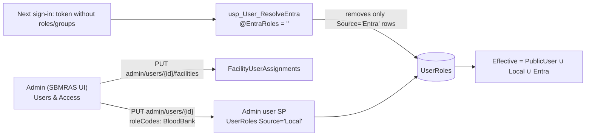

- Local roles are **never** removed by token sync; Entra-sourced roles are re-synced on every request.
- `GET admin/users/{id}` shows `roleSources` (`Local` / `Entra`) so reviewers can see where each role comes from.
- Mode C requires the same JML approvals and quarterly review as Mode A (§8.6.2), recorded in `AuditLogs`.
- Group names stored in SBMRAS (`Roles.EntraGroupName`) are **documentation only**; authorization never matches group names.
- The selected mode and its evidence (screenshots S-22, S-23, S-26) are recorded in the go-live checklist.

---

## 10. Threat model (STRIDE)

| # | STRIDE | Threat | Asset / entry point | Mitigations | Residual risk |
|---|---|---|---|---|---|
| T1 | **S**poofing | Forged or replayed JWT from another tenant/app | API bearer token | Signature via tenant JWKS, issuer + `tid` pinned, audience pinned, RS256 only, lifetime, `scp` check | Low |
| T2 | Spoofing | `X-User-Id` header impersonation | DevHeader mode | DevHeader only locally; IaC forces `EntraId`; smoke test; `dev-users` 404 in EntraId | Low (config error) |
| T3 | Spoofing | Account takeover via weak password / credential stuffing | User flow | Password policy, smart lockout, email verification, MFA via Conditional Access for institutional users, branding | Medium for public users |
| T4 | Spoofing | Takeover of a pre-provisioned account by registering the same email | `usp_User_ResolveEntra` email link | Email verified by External ID before token issuance; link only when `EntraObjectId IS NULL`; audit on link; Admin re-verifies institutional users | Low |
| T5 | **T**ampering | Client edits role/permission in browser, claims or JSON | SPA state, request body | Server computes permissions from DB; guards are UX only; role values from signed token only; no role fields accepted on non-admin endpoints | Low |
| T6 | Tampering | IDOR — change `facilityId` / `requestId` in URL | Facility & request endpoints | `fn_UserCanAccessFacility`, ownership checks in SPs → 403/404 | Low |
| T7 | Tampering | Lost updates on inventory | Inventory SPs | `rowVersion` concurrency → 409 | Low |
| T8 | **R**epudiation | Operator denies changing stock or approving a request | Audit | Append-only `AuditLogs` with actor, role, correlation ID, before/after, reason; Entra sign-in logs | Low |
| T9 | **I**nformation disclosure | Token theft via XSS | Browser storage | `sessionStorage` (tab-scoped), strict CSP, Angular sanitization, no `bypassSecurityTrust*`, short token lifetime | Medium (inherent to SPAs) |
| T10 | Information disclosure | Requester contact/PII leakage | Request endpoints, logs | Public search never returns requester data; contact only to owner/`requests.manage`; PII redacted in logs | Low |
| T11 | Information disclosure | Tokens or secrets in logs / Git | Logs, repo | Never log the Authorization header; GitHub secret scanning + push protection; no app secrets exist | Low |
| T12 | **D**enial of service | Flooding public search / request creation / sign-ups | Anonymous endpoints, user flow | WAF/APIM rate limits, `Idempotency-Key`, `pageSize` cap, Function scale limits, External ID bot protection | Medium |
| T13 | DoS | Metadata endpoint unavailable | JWKS fetch | Cached keys with automatic refresh; validation failure → 401 (fail closed) | Low |
| T14 | **E**levation of privilege | Public user obtains an institutional role | Group/app-role assignment | Sign-up never adds groups; assigned-membership groups with owners; app-role values allow-listed; overage/missing groups never grant; access reviews | Low |
| T15 | Elevation | Groups emitted as roles or misconfigured mapping | Token config | Emit-as-roles forbidden; `Groups:*` must be GUIDs; mapping reviewed in checklist | Low |
| T16 | Elevation | Admin removes own admin permissions / tenant lock-out | Roles API | SP keeps `users.manage` + `roles.manage` on Admin; break-glass accounts | Low |
| T17 | Elevation | New Function added without an auth attribute becomes public | API code | Startup reflection fails if any HTTP function lacks an auth attribute; unit test | Low |

---

## 11. Entra configuration screenshots required

Capture with the tenant name visible in the portal header. Client IDs, tenant ID and group object IDs are public identifiers and may
remain visible, but **never** capture passwords, OTP codes or full tokens of real users. Store under `docs/evidence/entra/` named
`S-xx_<short-name>.png`.

| ID | Portal blade path | What must be visible | Evidence purpose |
|---|---|---|---|
| S-01 | Entra admin center › Entra ID › Overview | Tenant type **External**, tenant name, Tenant ID, primary domain | Correct external tenant exists |
| S-02 | Entra ID › External Identities › User flows | `SBMRAS-SignUpSignIn` listed (Sign up and sign in) | User flow exists with the required name |
| S-03 | User flows › SBMRAS-SignUpSignIn › Identity providers | **Email with password** selected | Self-service email + password |
| S-04 | User flows › SBMRAS-SignUpSignIn › User attributes | Email Address, Given Name, Surname, Display Name ticked | Claims source for names |
| S-05 | User flows › SBMRAS-SignUpSignIn › Applications | `SBMRAS-Web` listed | Sign-up enabled for the SPA |
| S-06 | Live sign-up page (browser) | "Create account" page, then the email verification code prompt (code redacted) | Email verification during sign-up |
| S-07 | Entra ID › App registrations › SBMRAS-Web › Overview | Application (client) ID, tenant ID, supported account types | SPA registration identity |
| S-08 | SBMRAS-Web › Authentication | Platform **Single-page application**, redirect URIs (local 4400, dev/test/prod), implicit grant unchecked | Exact redirect URIs, PKCE only |
| S-09 | SBMRAS-Web › Certificates & secrets | **No** client secrets, **no** certificates | Public client has no secret |
| S-10 | SBMRAS-Web › API permissions | `SBMRAS-API access_as_user` Delegated, `openid`, `offline_access`, status **Granted for <tenant>** | Delegated permission + consent |
| S-11 | App registrations › SBMRAS-API › Overview | Application (client) ID, Application ID URI `api://<id>` | API identifier |
| S-12 | SBMRAS-API › Expose an API | Scope `access_as_user` Enabled, who can consent, authorized client `SBMRAS-Web` | Scope configuration |
| S-13 | SBMRAS-API › App roles | HospitalManagement, BloodBank, Admin — allowed member types Users/Groups, Enabled | App roles defined |
| S-14 | SBMRAS-API › Manifest | `requestedAccessTokenVersion: 2`, `appRoles` IDs, `groupMembershipClaims` | v2 tokens, fixed role IDs |
| S-15 | SBMRAS-API › Token configuration | Optional claims email, given_name, family_name, preferred_username (Access) + groups (Security groups, "emit as roles" **off**) | Claim configuration |
| S-16 | SBMRAS-API › Certificates & secrets | No secrets / certificates | API needs no secret |
| S-17 | Entra ID › Groups › All groups (search "SBMRAS-") | Three groups, type Security, membership Assigned, object IDs | Groups exist |
| S-18 | Groups › SBMRAS-Admin › Owners and Members | ≥ 2 owners; named members only | Least privilege for Admin |
| S-19 | Entra ID › Enterprise applications › SBMRAS-API › Users and groups | Each group → matching role (Hospital Management / Blood Bank / Administrator) | Group → app-role mapping (1:1) |
| S-20 | Enterprise applications › SBMRAS-API › Properties | Assignment required = **No** | Public users can obtain tokens |
| S-21 | Enterprise applications › SBMRAS-Web › Properties | Assignment required = **No** | Public sign-in permitted |
| S-22 | Decoded **public** access token (jwt.ms; signature part cropped) | `aud`, `iss`, `scp=access_as_user`, no `roles`, no `groups` | Public user has no institutional role |
| S-23 | Decoded **institutional** access token | `roles: ["BloodBank"]`, `groups: [<id>]`, `email`, `given_name`, `family_name`, `preferred_username` | Claims contract verified (SDD §6.3) |
| S-24 | Function App › Settings › Environment variables | `Auth__Mode=EntraId`, `Auth__Entra__*`, `Groups__*` (no secrets present) | API configuration |
| S-25 | Function App › API › CORS | Only exact SPA origin(s); no `*` | CORS allow-list |
| S-26 | SBMRAS › Administration › Users & Access › user detail | Role chips with source (Entra/Local), facility assignments | DB role sync + facility scope |
| S-27 | Browser devtools › Network | One 403 (forbidden) and one 401 (no token) with envelope message and `X-Correlation-Id` | 401 vs 403 behaviour |
| S-28 | Application Insights › Alerts › Alert rules | Rules for 401/403 spikes and admin 403 | Monitoring |
| S-29 | Entra ID › Monitoring & health › Sign-in logs (filter app SBMRAS-Web) | Successful and failed sign-ins | Sign-in auditing |
| S-30 | Entra ID › Identity Governance › Access reviews (or signed manual review record) | Review covering SBMRAS-* groups | Periodic access review |
| S-31 | Entra ID › Protection › Conditional Access (if available) | Policy requiring MFA for SBMRAS institutional/admin groups | MFA for privileged users |
| S-32 | GitHub › Settings › Environments › prod | `ENTRA_*` variables, required reviewers, secret names only | Deployment configuration |

---

## 12. Test and verification plan

| ID | Test | Expected |
|---|---|---|
| V-01 | `GET /api/v1/auth/config` | `mode=EntraId`, correct authority / scope / knownAuthority / userFlow |
| V-02 | New email → Create account | Email OTP required; after verification redirect to the app; `/me` roles = `[PublicUser]` |
| V-03 | Same user signs in again | Same `UserId` (no duplicate) |
| V-04 | Public user calls `GET admin/users` | 403 |
| V-05 | Protected endpoint without token | 401 |
| V-06 | Token for another audience (e.g. Graph), tampered signature, or expired | 401 |
| V-07 | Add user to `SBMRAS-BloodBank`, sign out/in, decode token | `roles` contains `BloodBank` (record Mode A/B/C, §9) |
| V-08 | Same token: `groups` claim | Group object ID present (Mode A) or absent (Mode B/C) |
| V-09 | BloodBank user `GET facilities/{unassigned}/blood-stock` | 403 "You are not assigned to this facility." |
| V-10 | BloodBank user `GET facilities/{hospital}/resources` | 403 (missing `resources.manage`) |
| V-11 | Remove user from group; new token | `BloodBank` removed from `UserRoles(Source='Entra')`; Local roles intact |
| V-12 | Admin sets `IsActive=0` | Next call 401 |
| V-13 | Token without `access_as_user` | 403 scope missing |
| V-14 | Unannotated HTTP function (unit test) | Test fails / host refuses to start |
| V-15 | Sign out | Landing page; `sessionStorage` cleared; Back button does not restore the session |
| V-16 | Admin removes `users.manage` from Admin role | Refused |
| V-17 | `Auth:Mode` invalid value | Startup failure |
| V-18 | CORS preflight from a non-allowed origin | No `Access-Control-Allow-Origin`; browser blocks |

---

## 13. Deployment checklist

**Tenant and identity**

- [ ] External tenant created; Tenant ID and `<subdomain>.ciamlogin.com` recorded (S-01)
- [ ] User flow `SBMRAS-SignUpSignIn` (`B2X_1_SBMRAS-SignUpSignIn`): Email with password; attributes Email / Given Name / Surname / Display Name (S-02–S-04)
- [ ] `SBMRAS-Web` added to the user flow (S-05); sign-up with email verification tested (S-06)
- [ ] Company branding + privacy/terms links configured
- [ ] `SBMRAS-API` registered; App ID URI `api://<id>`; scope `access_as_user`; `requestedAccessTokenVersion: 2` (S-11, S-12, S-14)
- [ ] App roles `HospitalManagement`, `BloodBank`, `Admin` with fixed IDs, enabled (S-13)
- [ ] Optional claims email / given_name / family_name / preferred_username on the access token; groups claim `SecurityGroup` without emit-as-roles (S-15)
- [ ] `SBMRAS-Web` registered as SPA; exact redirect URIs per environment; implicit grant off; no secrets (S-07–S-09)
- [ ] API permission `access_as_user` + `openid` + `offline_access` granted with admin consent (S-10); `SBMRAS-Web` pre-authorized on the API
- [ ] Groups `SBMRAS-HospitalManagement`, `SBMRAS-BloodBank`, `SBMRAS-Admin` (Security, Assigned, 2 owners) (S-17, S-18)
- [ ] Groups assigned to the matching app roles on the **SBMRAS-API** enterprise app; Assignment required = No on both apps (S-19–S-21)
- [ ] Real tokens decoded: public (no roles) and institutional (roles + claims) (S-22, S-23); §9 mode recorded

**Application and Azure**

- [ ] GitHub environment variables `ENTRA_*` (incl. `ENTRA_GROUP_*_ID`), `WEB_ORIGINS`, `AZURE_*` set per environment (S-32)
- [ ] Function App: `Auth__Mode=EntraId`, all `Auth__Entra__*` settings, `Cors__AllowedOrigins` (S-24)
- [ ] Function App CORS exact origins only (S-25); HTTPS only; TLS 1.2; Easy Auth off
- [ ] SQL scripts 01–12 applied; runtime MI granted (`GrantRuntimeIdentity.sql`); no SQL password in app settings
- [ ] First Admin provisioned (`ProvisionAdmin.sql`) and added to `SBMRAS-Admin`; break-glass accounts created and tested
- [ ] SPA built for the environment; CSP allows `https://*.ciamlogin.com`; smoke test `GET auth/config` returns `EntraId`
- [ ] Tests V-01–V-18 executed and evidence stored

**Operations**

- [ ] App Insights alerts for 401/403/5xx and DevHeader detection (S-28)
- [ ] Entra sign-in and audit logs exported to Log Analytics (S-29)
- [ ] Conditional Access / MFA for institutional and admin users (S-31), or documented compensating control
- [ ] Quarterly access review scheduled (S-30); JML procedure published to facility managers
- [ ] Secret scanning + push protection enabled on the repository
- [ ] Rollback plan and on-call contact recorded

---

## 14. Production-ready recommendations

### 14.1 Conditional Access and MFA

- Require **MFA** (email OTP or SMS where supported in External ID) for members of `SBMRAS-Admin`, `SBMRAS-HospitalManagement` and
  `SBMRAS-BloodBank` with a Conditional Access policy targeting those groups and the `SBMRAS-Web` / `SBMRAS-API` apps.
- Optionally require MFA for all users on **risky** sign-ins (requires the appropriate External ID add-on/licence).
- Exclude break-glass accounts from CA policies and monitor them instead.

### 14.2 Token lifetimes and sessions

- Keep platform defaults: access token ~60–90 min; SPA refresh token 24 h (fixed); do not lengthen.
- Use `sessionStorage`, never `localStorage`. Sign-out ends the External ID session and the app session.
- Immediate revocation: SBMRAS `IsActive=0` (effective on the next request) + Entra **Revoke sessions**.

### 14.3 CORS

- Exact origins per environment, configured in both Function App platform CORS and `Cors:AllowedOrigins`; no `*`, no localhost in prod.
- Methods `GET, POST, PUT, OPTIONS`; headers `Authorization, Content-Type, X-Correlation-Id, Idempotency-Key` (+ `X-User-Id` locally only).

### 14.4 Key Vault and managed identity

- No client secrets exist by design. SQL access via the **user-assigned managed identity**; prefer **Microsoft Entra-only
  authentication** on Azure SQL (disable SQL logins after bootstrap).
- If a secret is ever introduced, store it in Key Vault (RBAC mode, purge protection) and reference it from app settings
  (`@Microsoft.KeyVault(SecretUri=...)`); rotate at least every 90 days.

### 14.5 Logging and alerting on 401/403

- Emit structured events `AuthenticationFailed` and `AuthorizationDenied` with correlation ID, function name, permission code, user ID
  (if known), facility ID and hashed client IP. Never log tokens, OTPs or contact details.
- KQL alert examples:

```kusto
requests
| where timestamp > ago(5m) and url has "/api/v1/" and resultCode in ("401", "403")
| summarize Failures = count() by resultCode, bin(timestamp, 5m)
| where (resultCode == "401" and Failures > 50) or (resultCode == "403" and Failures > 20)
```

```kusto
traces
| where timestamp > ago(15m) and message has "AuthorizationDenied"
| where tostring(customDimensions.Route) startswith "admin/"
```

### 14.6 Least privilege

- Default role is `PublicUser`; institutional roles only via approved group membership (or Local fallback) **plus** facility assignment.
- `SBMRAS-Admin` ≤ 5 people; use PIM (eligible, time-bound) for Entra roles such as Groups Administrator / Application Administrator.
- Function runtime MI: `EXECUTE` + read/write only; no `db_owner`; no UPDATE/DELETE path on `AuditLogs`.
- GitHub deploy identity: Contributor on its own resource group only.

### 14.7 Periodic access review

- Quarterly review of all three groups and of `UserRoles(Source='Local')` + `FacilityUserAssignments` (from **Administration › Users &
  Access**). Remove institutional users with no `LastLoginAt` in 90 days.
- Annual review of app registrations: owners, redirect URIs, permissions, absence of secrets.

### 14.8 Break-glass administrator

- Two cloud-only accounts in the external tenant (e.g. `sbmras-bg1@<tenant>.onmicrosoft.com`) with strong unique passwords stored
  offline (sealed / split knowledge), excluded from Conditional Access, members of `SBMRAS-Admin`, with the Local `Admin` role
  pre-provisioned in SBMRAS (`ProvisionAdmin.sql`) so they work even if group-to-role mapping breaks.
- Alert on **any** sign-in by these accounts; test twice a year.

### 14.9 Secrets hygiene

- Commit only `local.settings.sample.json`; `local.settings.json` is git-ignored.
- Enable GitHub **secret scanning** and **push protection**; Dependabot for `@azure/msal-browser` and `Microsoft.IdentityModel.*`.
- Never place secrets, tokens or production data in Angular environment files, logs, screenshots or tickets.

### 14.10 Other hardening

- Rate limiting / WAF (Azure Front Door or API Management) on `public/*` and `POST requests` in production.
- Separate External ID tenant (or at least separate app registrations) for production; no test users in prod.
- Review Microsoft Entra External ID release notes before each release for changes to groups/roles claim behaviour (§9).

---

## 15. Glossary

| Term | Meaning |
|---|---|
| External ID | Microsoft Entra External ID for customers (CIAM); authority host `*.ciamlogin.com` |
| User flow | Configured sign-up/sign-in experience (`B2X_1_SBMRAS-SignUpSignIn`) |
| App role | Role defined on `SBMRAS-API`, emitted in the `roles` claim |
| Delegated scope | Permission the SPA uses on behalf of the user (`access_as_user`) |
| Overage | Too many groups for the token; Entra replaces `groups` with a pointer |
| PKCE | Proof Key for Code Exchange — protects the authorization code for public clients |
| Facility scope | Restriction of institutional users to assigned facilities (`FacilityUserAssignments`) |
| JML | Joiner / mover / leaver identity lifecycle |
